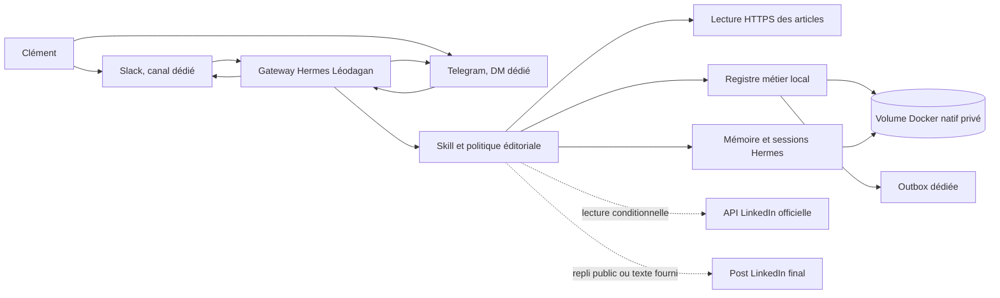

# Spécifications techniques — Léodagan

Date : 15 octobre 2026. Ce document décrit la cible de développement. Aucun nouveau déploiement ni premier run n'a été exécuté pendant le cadrage ; seul l'ancien conteneur Léodagan et son réseau dédié ont été retirés après inventaire.

## 1. Références, état examiné et limites

**Consignes applicables :** `AGENTS.md` à la racine, `docs/agent-creation-checklist.md`. Aucun `AGENTS.md` supplémentaire n'existe sous `leodagan/` au 15 octobre 2026. Dépôt projet : révision `ab08443f4a455a221351b0a55c9bb25aef1db5a7`, état initial propre.

**Projet existant lu :** `README.md`, `leodagan/README.md`, `leodagan/TODO.md`, `leodagan/compose.yaml`, `leodagan/config/config.yaml`, `leodagan/prompts/editorial-policy.md`, `leodagan/prompts/image-style.md`, `leodagan/skills/leodagan/SKILL.md`, `leodagan/docs/{access-matrix,operations,slack-notifications,telegram-notifications}.md`, `leodagan/config/{.env,slack.env,telegram.env}.example`, et les scripts/tests versionnés. Le runtime privé contient manifestement sessions, bases et secrets ; ses valeurs n'ont pas été lues. L'application actuelle est une veille planifiée avec mémoire désactivée, sortie locale et notifications ; ses règles de deux sources, de thème et de cron ne conviennent plus. Les éléments réutilisables sont le slug, l'isolation générale, une partie de la direction artistique, l'identité Slack dédiée, les contrôles d'idempotence et les tests de livrable, à adapter.

**Hermes de référence local :** `/Users/clement/workspace/hermes-agent`, commit `bd0affe5e5f723579df8902852f5d0c47795f355`, description de travail `v0.21.4+canary.20261003T070620Z-dirty` (arbre non propre). Fichiers vérifiés : `README.md`, `Dockerfile`, `docker-compose.yml`, `tools/environments/docker.py`, `tools/memory_tool.py`, `tools/memory_tool_store.py`, `hermes_cli/models_catalog_static.py`, `agent/reasoning_effort.py`, `hermes_cli/auth.py`, `hermes_cli/toolset_validation.py`, `gateway/authz_mixin.py`, `gateway/pairing.py`. La version de l'image Docker déjà configurée est épinglée par digest dans `leodagan/compose.yaml` ; son contenu effectif n'a pas pu être vérifié. Toute syntaxe définitive sera validée contre l'image réellement retenue.

**Documentation Hermes publique consultée :** [Docker](https://hermes-agent.nousresearch.com/docs/user-guide/docker), [profils](https://hermes-agent.nousresearch.com/docs/user-guide/profiles), [Slack](https://hermes-agent.nousresearch.com/docs/user-guide/messaging/slack), [Telegram](https://hermes-agent.nousresearch.com/docs/user-guide/messaging/telegram), [outils/toolsets](https://hermes-agent.nousresearch.com/docs/user-guide/features/tools), [référence toolsets](https://hermes-agent.nousresearch.com/docs/reference/toolsets-reference), [mémoire](https://hermes-agent.nousresearch.com/docs/user-guide/features/memory), [sessions](https://hermes-agent.nousresearch.com/docs/user-guide/sessions), [skills](https://hermes-agent.nousresearch.com/docs/user-guide/features/skills), [plugins](https://hermes-agent.nousresearch.com/docs/user-guide/features/plugins), [MCP](https://hermes-agent.nousresearch.com/docs/user-guide/features/mcp), [cron](https://hermes-agent.nousresearch.com/docs/user-guide/features/cron), [hooks](https://hermes-agent.nousresearch.com/docs/user-guide/features/hooks), [sécurité](https://hermes-agent.nousresearch.com/docs/user-guide/security). Documentation externe utile : [limite des posts LinkedIn](https://www.linkedin.com/help/linkedin/answer/a522483/differences-between-posting-and-publishing?lang=en), [Posts API](https://learn.microsoft.com/en-us/linkedin/marketing/community-management/shares/posts-api), [statistiques des posts personnels](https://learn.microsoft.com/en-us/linkedin/marketing/community-management/members/post-statistics).

**État Docker constaté après le cadrage :** le 15 octobre 2026, une inspection Docker a confirmé que l'ancien `hermes-leodagan` tournait, sain, dans le réseau `hermes-leodagan_default`. Ses deux bind mounts pointaient vers `/Users/clement/workspace/my-hermes/leodagan/runtime` et `/Users/clement/workspace/my-hermes/leodagan/review-inbox`, chemins qui **n'existaient plus sur l'hôte** au moment de l'inspection. Aucun volume Docker nommé ne portait le nom de Léodagan. Les conteneurs Père Blaise et Yvain avaient des projets, réseaux et montages distincts. Le répertoire `leodagan/runtime` de ce dépôt existe (environ 15 Mio) mais n'était **pas** le montage déclaré de l'ancien conteneur ; sa provenance doit être vérifiée avant reprise de données. Après vérification que l'ancien réseau ne contenait que Léodagan, le conteneur `hermes-leodagan` et le réseau `hermes-leodagan_default` ont été retirés. **Aucun volume, image, bind mount, répertoire de données ou autre conteneur n'a été supprimé.** Père Blaise et Yvain ont été revérifiés actifs ensuite.

**Autres limites de vérification :** l'accès au socket Docker exigeait une permission élevée pour cette inspection ; aucun test de modèle, canal ou premier run n'a été exécuté. Les sept posts LinkedIn publics ont été lus via navigateur, mais cet accès invité peut disparaître. Les droits `r_member_social` et `r_member_postAnalytics` ne sont pas présumés accordés ; `r_member_social` est [réservé aux applications approuvées](https://learn.microsoft.com/en-us/linkedin/marketing/community-management/shares/posts-api). Les exemples Obsidian sont des références de style, pas des consignes d'exécution.

## 2. Architecture cible et frontières de confiance

Le déploiement cible crée un **conteneur Hermes nommé exactement `hermes-leodagan`** (service Compose `leodagan`, projet `hermes-leodagan`) pour le gateway et ses adaptateurs Slack/Telegram. L'ancienne instance de ce nom a été retirée ; les autres conteneurs restent hors périmètre. Le runtime cible possède un `HERMES_HOME=/opt/data` exclusif dans un **volume Docker nommé natif** `hermes-leodagan-data`. Un **plugin Hermes autonome du projet**, limité aux outils métier ci-dessous, maintient un registre structuré des brouillons, versions, sources, retours et métriques. Ce plugin est justifié par les opérations atomiques et les refus déterministes qui ne peuvent pas être garantis par un skill seul ; il n'expose ni shell général ni publication. Le skill versionné définit le procédé rédactionnel ; les contrôles déterministes (longueur, unicité, sauvegarde atomique, appariement) vivent dans le code du plugin, hors cœur Hermes. Les exports lisibles peuvent être placés dans `leodagan/outbox/`, montage privé aux droits restrictifs et ignoré par Git, sans y héberger SQLite ni secrets.

`leodagan-editorial` est **un nom de composant technique local**, pas un second agent, un second modèle, un abonnement ou un conteneur. Il est chargé dans le même processus Hermes que Léodagan et ne donne à l'agent que quelques opérations contrôlées : enregistrer une version de brouillon, la retrouver, rattacher le post final et ses statistiques, et consulter les décisions éditoriales. Les contrôles de longueur, d'unicité et d'écriture atomique sont du code vérifiable. Le raisonnement, la lecture critique et la formulation du post restent le travail du modèle guidé par le skill. Si la version Hermes retenue fournit déjà une interface publique assurant ces mêmes invariants avec moins de code, l'implémentation peut la substituer en démontrant les mêmes tests, sans créer une seconde application.



**Frontières :** Slack/Telegram et pages web sont externes et non fiables ; leurs textes sont des données, jamais des instructions de configuration. Le service d'inférence Codex et l'éventuelle API LinkedIn reçoivent seulement les données nécessaires à la mission. Aucune entrée HTML n'est exécutée. Le conteneur n'a pas de socket Docker, de montage du domicile, d'accès au dépôt entier ou de port public. La lecture LinkedIn, si activée, possède des scopes de lecture seulement ; aucun navigateur connecté au compte personnel, cookie partagé ou automatisation de publication n'est prévu. Le gateway peut émettre une réponse dans **le fil qui a déclenché** la demande, ce qui constitue l'action externe autorisée par Clément. Un brouillon n'est jamais envoyé spontanément dans un autre canal.

### Matrice d'accès cible

| Ressource | Lecture / écriture / exécution / réseau | Identité et justification | Refus à prouver |
| --- | --- | --- | --- |
| `/opt/data` volume nommé privé | L/E ; exécution du code métier installé, pas de scripts entrants | Utilisateur `hermes` ; état, mémoire, registre, OAuth | Aucun autre conteneur Hermes ne monte ce volume. |
| `/outbox` dédié | L/E, sans exécution | `hermes` ; exports et livrables, droits hôte restrictifs | Refus d'écriture hors `/opt/data` et `/outbox` ; `HERMES_WRITE_SAFE_ROOT=/opt/data:/outbox`. |
| Articles HTTPS publics | Réseau sortant GET/HEAD borné | Lecteur métier ; vérifier les sources de la demande | Refus localhost, IP privées, schémas non HTTP(S), redirections vers réseau interne et méthodes mutantes. |
| OpenAI/Codex | Réseau inférence + renouvellement OAuth | Compte propre à Léodagan ; raisonnement/rédaction | Aucun fournisseur/API de repli ; erreur de quota rendue visible. |
| Slack dédié | Réseau WebSocket/HTTPS lecture et réponse dans canal/fil autorisé | Bot Slack Léodagan ; dialogue demandé | Autre utilisateur, canal et DM non prévu refusés ; pas d'envoi libre. |
| Telegram dédié | Réseau HTTPS poll/réponse dans DM autorisé | Bot Telegram Léodagan ; dialogue demandé | Autre utilisateur ou groupe refusé. |
| LinkedIn API optionnelle | Réseau GET, lecture de post/statistiques | OAuth lecture de Clément ; comparaison | Aucun scope `w_*`, POST/PATCH/DELETE et autre auteur refusés. |
| Hôte, autres dépôts, Docker daemon | Aucun montage ni réseau spécial | Sans justification métier | Accès au domicile, Père Blaise, socket Docker et port public refusés. |

**Docker exécutant Hermes ≠ Docker exécutant les outils Hermes :** la première notion est ici le conteneur Compose du gateway. La seconde correspond à `terminal.backend: docker` et ferait créer des conteneurs d'outils, généralement avec accès au daemon Docker. Elle n'apporte rien à la lecture HTTPS et au registre borné et compliquerait l'isolation sur Docker Desktop ; elle reste désactivée. Les outils nécessaires s'exécutent dans le conteneur Hermes avec permissions minimales. [La documentation Docker Hermes](https://hermes-agent.nousresearch.com/docs/user-guide/docker) distingue explicitement ces deux mécanismes.

## 3. Choix des capacités Hermes

| Besoin | Capacité Hermes | Configuration ou extension | Pourquoi / limite | Test |
| --- | --- | --- | --- | --- |
| Dialogue Slack/Telegram | Gateway et adaptateurs officiels | Un seul profil/runtime Léodagan, `SLACK_BOT_TOKEN`, `SLACK_APP_TOKEN`, `SLACK_ALLOWED_USERS`, `SLACK_ALLOWED_CHANNELS`, `TELEGRAM_BOT_TOKEN`, `TELEGRAM_ALLOWED_USERS` ; Socket Mode Slack | Réponse dans fil Slack et DM Telegram sans port entrant ; vérifier scopes et application Slack dédiée. | T-CANAL |
| Lecture d'articles | `web_extract`/`web_search` si disponibles avec l'abonnement ; sinon lecteur HTTPS borné du plugin projet | Toolsets `web` seulement si fournisseur/outils réellement accessibles ; extraction avec timeout, taille et domaines contrôlés | Un lien payant/inaccessible déclenche le repli utilisateur ; navigateur interactif non requis par défaut. | T-SOURCE |
| Rédaction, lecture critique et prompt visuel | Skill `leodagan`, politique et exemples versionnés | `skills/<slug>/SKILL.md`, prompts paramétrables ; un seul modèle | Procédure stable ; analyser les articles comme CTO/DSI/dirigeant avant de produire le post. | T-STYLE, T-CRIT, T-IMAGE |
| Limite de longueur et archivage | Contrôles locaux déterministes | Plugin autonome `leodagan-editorial` pour valider/enregistrer/versionner ; sortie structurée | LLM seul ne garantit ni 3 000 caractères ni écriture atomique. | T-DRAFT |
| Préférences durables | Mémoire Hermes `USER.md`/`MEMORY.md` | `memory_enabled: true`, `user_profile_enabled: true`, toolset `memory` ; consentement détaillé dans la politique | Mémoire courte, réservée aux règles confirmées ; données volumineuses dans registre métier. | T-MEM |
| Retrouver anciennes discussions | `session_search` | Activer sur Slack/Telegram si disponible ; rétention cohérente avec conservation décidée | Recherche utile pour contexte, mais registre métier fait foi pour versions. | T-RECALL |
| Isolation | Profil ou runtime Hermes dédié | Un `HERMES_HOME` propre, un volume natif, tokens distincts | Aucun partage avec Père Blaise ; ne pas cloner son OAuth. | T-ISO |
| Lecture du post final / statistiques | API LinkedIn officielle, via extension projet en lecture seule si scopes obtenus | OAuth privé `r_member_social` et `r_member_postAnalytics` seulement ; endpoints GET ; sinon page publique puis texte/chiffres fournis | Permissions conditionnelles ; ne jamais demander `w_member_social`. | T-LI |
| Connecteur externe | Plugin métier existant ; MCP évalué | **Ne pas activer LinkedIn par défaut.** Si API approuvée, ajouter au même plugin deux outils de lecture GET étroits ; ne pas créer de MCP séparé | Plus petite surface ; aucune modification du cœur Hermes ni outil avec droit d'écriture. | T-LI, T-NEG |
| État/alerte | Logs et healthcheck gateway ; module métier | Statut et erreur par brouillon, logs redigés ; notification dans le fil courant | Un hook passif peut être ajouté seulement si défaut de livraison non observable autrement. | T-OPS |
| Planification | Cron Hermes | **Désactivé / anciens jobs en pause puis retrait après inventaire et validation** | À la demande uniquement, y compris statistiques. | T-NO-CRON |
| Sous-agents/délégation | `delegate_task` | Désactivés | Pas de sous-tâche nécessitant un autre agent ou profil ; coût et mémoire supplémentaires injustifiés. | T-NEG |
| Recherche web supplémentaire | `web_search` | Facultative et bornée pour vérifier une affirmation du post | Ne remplace pas l'article fourni ; signaler les sources ajoutées. | T-SOURCE |
| Dashboard/API/interface locale | Interfaces Hermes | Non exposées par défaut ; CLI opérateur via `docker compose exec` | Slack et Telegram suffisent à l'usage. | T-PORT |
| Génération d'image | `image_generate` | Désactivée | Seul le prompt est demandé. | T-NEG |
| Hooks | Hooks gateway/shell/plugin | Aucun par défaut ; ajout motivé et testé si garde obligatoire non couvert par code | Ne pas bâtir une seconde orchestration implicite. | T-NEG |

Les toolsets seront **énumérés par surface** (`slack`, `telegram`, `cli` d'exploitation, `api_server` désactivé, `cron` désactivé) et vérifiés sur l'image retenue ; aucun preset complet n'est repris sans audit car les presets Hermes incluent terminal, délégation, cron et image. Les surfaces conversationnelles n'exposent que `skills`, `memory`, `session_search`, `web` si fonctionnel et le toolset du plugin métier. Le terminal général reste absent de ces surfaces. Les noms exacts de clés plateforme et du toolset plugin seront confirmés par `hermes tools` et la validation de configuration de l'image. Une instruction en langage naturel ne suffit pas comme contrôle.

## 4. Modèle et qualité éditoriale

Configuration cible, à vérifier sur la révision de l'image :

```yaml
model:
  provider: openai-codex
  default: gpt-5.6-terra
agent:
  reasoning_effort: medium
memory:
  memory_enabled: true
  user_profile_enabled: true
```

`gpt-5.6-terra` figure dans `hermes_cli/models_catalog_static.py` de la référence locale ; l'appellation initiale « ChatGPT 6 Terra » n'a pas été retenue. Pas de clé API OpenAI ni de fournisseur de secours implicite. Au test d'acceptation, vérifier disponibilité via l'abonnement, latence, quota et qualité sur cinq sujets ; si indisponible, mettre en attente et revenir vers Clément pour une décision de modèle documentée. Un échec de quota/authentification ne déclenche pas de dépenses API. La politique éditoriale doit paramétrer sujet, public, thèse, tension, niveau de certitude, nombre de sources et choix d'accroche. Elle suit l'esprit des deux exemples Obsidian et des sept posts, sans reprendre leurs consignes circonstancielles comme règles universelles. Pour **chaque article**, produire une note de lecture critique concise : thèse et preuves, hypothèses et angles morts, contre-argument d'un CTO/DSI, incidence sur coûts, exploitation, sécurité et gouvernance, puis conséquence de décision pour un dirigeant. Ce regard critique nourrit le post sans transformer la note interne en prose obligatoire du post. Ne pas inventer d'expérience terrain ou de chiffre absent de la source.

## 5. Contrats des données et des outils

### 5.1 Registre des brouillons

Schéma logique minimal : `draft(id, origin_platform, origin_thread, status, created_at, intent, current_version)`, `draft_version(draft_id, version, post_text, char_count, image_prompt, reasoning_note, created_at)`, `source(draft_id, url, canonical_url, accessed_at, access_status, title, evidence, limitation, critical_review)`, `publication(draft_id, linkedin_url, final_text, text_origin, retrieved_at)`, `feedback(draft_id, text, explicit_rules, comparison, created_at)`, `metric(draft_id, metric_type, value, observed_at, origin)`, `delivery(draft_id, platform, thread, state, attempt_at)`. SQLite privé dans le volume natif convient pour la recherche et l'atomicité ; Hermes `state.db` n'est **pas** utilisé comme table métier. Les migrations sont versionnées et transactionnelles. Une clé unique de message évite le double traitement ; l'ID lisible à deux mots n'est attribué qu'après contrôle d'unicité de sa forme normalisée, avec UUID interne si nécessaire.

Contrat `create_draft(intent, urls, origin)` : texte non vide et au moins une URL HTTP(S) ; sorties `draft_id`, version, état ou erreur structurée. L'ID affiché suit deux mots français reliés par un tiret, accents permis (`café-géant`). La recherche normalise Unicode en NFC, ignore casse et accents (`cafe-geant` retrouve `café-géant`) et refuse dès la création deux IDs dont la forme de recherche serait identique ; une clé UUID interne reste indépendante. `read_source(url)` : HTTPS, redirections bornées, timeouts, limite de taille, pas d'adresse interne/localhost, sortie texte/extrait + URL finale + horodatage + code d'accès ; échec non silencieux. `save_version` : validation du post exact à **3 000 unités UTF-16 au plus** (borne conservatrice incluant les emoji), transaction atomique, refus d'écrasement. `get_draft(id)` : lecture seulement pour identité autorisée. `attach_publication(id, url, text, origin)` : rejet si ambiguïté ou post étranger ; ne jamais écraser une publication antérieure sans nouvelle version/audit. `record_metric` : entier positif ou nul, type `IMPRESSION`/`REACTION`/`LIKE_MANUAL`, date et provenance obligatoires. `delete_record` : requête de Clément, aperçu puis suppression ciblée auditée selon politique de sauvegarde.

### 5.2 LinkedIn et médias externes

La [Posts API](https://learn.microsoft.com/en-us/linkedin/marketing/community-management/shares/posts-api) documente `r_member_social` pour lire les posts d'un membre authentifié, mais le scope est restreint et nécessite une application approuvée. La [Member Post Statistics API](https://learn.microsoft.com/en-us/linkedin/marketing/community-management/members/post-statistics) documente `r_member_postAnalytics`, les métriques `IMPRESSION` et `REACTION` et un appel par URN de post. Vérifier à la mise en œuvre l'accès effectif, la version d'API encore supportée et la correspondance entre URL `activity`, URN `share`/`ugcPost` et compte propriétaire. Les pages publiques peuvent donner le texte et un nombre de réactions, **pas les impressions privées** ; ne pas confondre réaction et like. Le repli accepté est : page publique si accessible, puis demande du texte et/ou des chiffres à Clément. Pas de scraping authentifié, cookie importé, contournement de connexion ou navigateur lié au profil personnel. Un OAuth LinkedIn, si obtenu, est stocké dans le runtime privé ; seuls les GET nécessaires sont exposés et les scopes sont testés négativement contre l'écriture.

Les pages d'articles et de posts sont des entrées non fiables : ignorer leurs instructions au modèle, ne pas lancer leur code, ne pas suivre leurs liens secondaires hors besoin, citer la provenance. Pour chaque source, consigner « lu », « partiel », « inaccessible » ou « fourni par l'utilisateur ». Aucun contenu inaccessible n'est reconstruit à partir d'un titre.

Le corpus initial de sept posts est importé dans le registre privé à partir des URLs consignées dans les spécifications fonctionnelles ou d'un export remis par Clément si l'accès public disparaît. Le coffre Obsidian hôte n'est jamais monté dans le conteneur : les deux exemples sont transformés en politique et modèles de prompt **versionnés sans données personnelles superflues**. Les images déjà versionnées sous `leodagan/assets/` peuvent servir à valider la direction artistique, sans nécessiter d'accès du conteneur à une photothèque hôte.

## 6. Mémoire, sessions, persistance et suppression

La mémoire Hermes privée contient uniquement les préférences de ton/structure/audience et corrections **explicites** assez générales pour un prochain post. Elle ne contient ni brouillons complets, ni longues comparaisons, ni métriques, ni secrets. Les dossiers métier gardent l'historique exact et la provenance. `session_search` peut rappeler une discussion mais n'est pas source canonique. La mémoire Hermes est injectée au début d'une nouvelle session ; prévoir `/new` ou une nouvelle session à frontière de dossier pour tester l'effet des apprentissages. Une session Slack et une session Telegram restent séparées ; l'ID réunit les dossiers métier, sans partage automatique de contexte privé.

Rétention : conservation jusqu'à suppression explicite pour données métier, mémoire et sessions pertinentes. Revoir `sessions.auto_prune`/`retention_days` de l'image, car un défaut de purge contredirait cette décision ; configurer la rétention en conséquence sans promettre « illimité » si l'espace manque. La consultation/correction/suppression passe par commandes opérateur ou dialogue autorisé ; supprimer aussi index, extraits et copies exportées. Les sauvegardes chiffrées sont cataloguées et une suppression doit soit purger les archives concernées, soit empêcher une restauration qui réintroduit la donnée. Le délai technique de purge d'anciennes sauvegardes est à fixer dans le runbook avant production ; jusqu'à cela, signaler honnêtement la portée d'une suppression.

## 7. Docker Desktop macOS, réseau et secrets

Compose : service `leodagan`, projet `hermes-leodagan`, **`container_name: hermes-leodagan`**, image Hermes par digest validé, `restart: unless-stopped` seulement après recette, utilisateur Hermes non privilégié, capacités minimales nécessaires au point d'entrée officiel, `no-new-privileges`, limites CPU/RAM/PID mesurées, `tmpfs /tmp`, aucun port hôte publié. Réseau sortant HTTPS vers OpenAI/Codex, Slack, Telegram, URLs données et éventuellement API LinkedIn ; pas de réseau hôte. Healthcheck du gateway avec test d'activité réel et délai raisonnable ; l'état métier est contrôlé séparément. L'ancien digest est un point de départ à vérifier, pas une validation de la nouvelle mission.

**SQLite sur macOS :** [Hermes avertit](https://hermes-agent.nousresearch.com/docs/user-guide/docker) que `state.db` en WAL sur un bind mount traversant la VM Docker Desktop peut être corrompu silencieusement. Depuis v2026.9.14, une base neuve sur virtiofs/9p est créée en mode `DELETE` ; une base WAL existante ne doit jamais être convertie à chaud. La cible utilise `hermes-leodagan-data:/opt/data`, volume nommé natif ext4 de la VM, pour l'état Hermes **et** le registre métier SQLite ; WAL y est acceptable. `leodagan/outbox/` peut rester un bind mount pour fichiers texte seulement. L'ancien conteneur a été retiré, sans volume nommé à supprimer ; `leodagan/runtime/` dans ce dépôt et `review-inbox/` restent à inventorier avant réutilisation ou purge. Clément autorise une remise à zéro de **Léodagan seulement** si l'inventaire confirme l'absence de dépendance d'un autre agent ou logiciel. Une sauvegarde de récupération est recommandée avant la purge des données ; la suppression ciblée suit la règle de présentation des chemins et tailles d'`AGENTS.md`.

Secrets : création interactive dans le volume privé, droits restrictifs (`0600` pour `.env`/tokens), aucune valeur réelle ni placeholder ressemblant à un vrai token dans Git, logs ou exemples. Auth Codex **dans le runtime de Léodagan** ; ne pas copier le jeton de Père Blaise (`scripts/adopt-codex-auth.sh` est à retirer du parcours lors du développement). Slack utilise l'application dédiée existante, auditée pour Socket Mode, bot/app token, événements et scopes minimaux. Telegram reçoit un bot dédié via BotFather ; Clément fournit l'ID autorisé hors dépôt. LinkedIn éventuel : consentement OAuth de lecture, scopes vérifiés, possibilité de révocation. Sauvegardes chiffrées séparées, restauration et rotation testées ; aucun secret en variable affichée ou trace de commande.

## 8. Structure prévue et extensions

```text
leodagan/
  README.md                  # mission, décisions, mise en service et runbook
  compose.yaml               # service isolé, volume nommé
  config/                    # config Hermes versionnée, exemples sans secret
  prompts/                   # politique et modèles de rédaction/illustration
  skills/leodagan/SKILL.md   # procédure réutilisable
  plugins/leodagan-editorial/ # outils Hermes métier à surface étroite
  src/                       # logique pure : registre, validateur, lecteur, comparateur, adaptateur LinkedIn éventuel
  migrations/                # schéma métier versionné
  scripts/                   # cycle de vie et migration contrôlée
  tests/                     # comportement, intégration, Docker, refus
  docs/specs/                # présentes spécifications et prompt de développement
  docs/                      # accès, exploitation, confidentialité, décisions
  outbox/                    # exports privés à droits restrictifs, hors Git
```

Le plugin autonome est la seule extension prévue au-delà de la configuration et du skill ; le même code fournit une CLI d'exploitation hors dialogue pour inventaire, export et suppression. Un MCP ne sera retenu que si un serveur externe existant, nécessaire et filtrable apporte une capacité que le plugin ne couvre pas ; aucun n'est identifié actuellement. Un changement du cœur `/Users/clement/workspace/hermes-agent` nécessiterait une lacune reproduite, un test, une justification et une décision séparée ; aucun besoin actuel ne le requiert.

## 9. Cycle de vie local : contrats des scripts à développer

Tous les scripts qui copient ou manipulent un déploiement utilisent `set -euo pipefail`, valident variables et chemins physiques, affichent source/destination, refusent racines interdites et liens symboliques suivis, prévisualisent volume/tailles, déploient vers un staging et ne basculent qu'après validation conformément à `AGENTS.md`. Budget initial de copie de la **source versionnée Léodagan seule : 20 Mio** (état suivi au cadrage : environ 0,57 Mio) ; si les ajouts légitimes le dépassent, modifier ce budget dans le README après revue avant toute copie. Jamais de `--delete` ou de suppression d'ancien déploiement sans validation humaine après affichage des chemins et tailles. Les scripts doivent être idempotents ou refuser clairement une opération répétée dangereuse.

Destination locale proposée : `/Users/clement/workspace/hermes-knights-grail/.deployments/leodagan`, ignorée par Git, avec releases immuables sous `releases/<version>` et pointeur `current` basculé seulement après test du staging. La source autorisée est le chemin physique `/Users/clement/workspace/hermes-knights-grail/leodagan` ; le script vérifie explicitement ces préfixes et le slug. Cette destination est réversible et peut être ajustée dans le README avant implémentation sans modifier les exigences de sécurité. Le volume nommé et les sauvegardes ne résident pas sous ce répertoire de source à copier.

| Opération | Contrat précis |
| --- | --- |
| `install` | Prérequis Docker Desktop, Compose, espace disque ; vérifier image/digest, créer **sans écraser** projet/volume/outbox, copier seulement source versionnée Léodagan via staging ; afficher plan et état. |
| `configure` | Proposer provisionnement privé Codex, Slack, Telegram et LinkedIn optionnel ; contrôler permissions et allowlists sans afficher valeurs ; configurer modèle, réseau et mémoire. |
| `start` | Valider configuration, présence secrets nécessaires, volume et absence de gateway concurrent ; démarrer ; attendre santé ; pas de cron. |
| `stop` | Arrêt gracieux du service, conserver conteneur/volume/données, retour d'état fiable. |
| `restart` | Stop/start contrôlé et vérification du retour des brouillons ; aucun job spontané. |
| `status` | État Compose, santé gateway, connectivité canaux et modèle (tests non intrusifs), espace, dernier incident, sans secret. |
| `logs` | Journaux bornés et redigés, filtres période/niveau/identifiant, aucun token ou corps privé complet par défaut. |
| `update` | Pause/arrêt, sauvegarde vérifiée, nouvel artefact en staging, migration transactionnelle, test de fumée, bascule ; conserver image/config précédentes pour retour. |
| `backup` | Snapshot cohérent du volume SQLite (arrêt ou API backup SQLite), outbox, configuration privée et secrets chiffrés ; manifeste, somme de contrôle et test de lisibilité. |
| `restore` | Vers runtime privé arrêté, jamais sur instance active ; vérification manifeste et intégrité, validation de l'identité et des droits, test fonctionnel avant bascule. |
| `uninstall` | Arrêt et retrait des services/ressources recréables **sans supprimer** volume, outbox, sauvegardes ni secrets ; afficher leurs chemins/volumes conservés. |
| `purge` | Commande distincte, présente liste exacte des données, volumes, secrets, exports et sauvegardes visés avec chemins/tailles ; confirmation explicite après cet aperçu ; refuse nom ambigu et ne touche aucun autre agent. |

Un `update` qui échoue revient à l'image et à la configuration validées ; si schéma non rétrocompatible, restaurer le snapshot antérieur et garder l'agent arrêté jusqu'au contrôle. Le remplacement de l'ancien runtime produit un inventaire de périmètre, un dry-run de retrait et une preuve de non-partage. Les ressources Docker propres à Léodagan peuvent ensuite être supprimées ; celles d'autres agents, les données du système et Docker Desktop restent intactes. Les jobs cron actuels sont arrêtés avec l'ancien runtime et ne sont pas recréés. **La livraison du projet inclut le déploiement du nouveau `hermes-leodagan` et un premier run de brouillon et prompt d'image par un canal autorisé**, puis une vérification de persistance après redémarrage ; le simple succès des tests unitaires ne suffit pas.

## 10. Tests et traçabilité

| Preuve | Contrôle réel requis | Exigences couvertes |
| --- | --- | --- |
| T-CANAL | Échanges réels Slack/Telegram, bon fil/DM, refus utilisateur et canal non autorisés, coupure de livraison. | F-001, F-017, F-022 |
| T-NO-CRON | Démarrage/redémarrage et inspection scheduler sans déclenchement autonome. | F-002 |
| T-SOURCE | Article accessible, lien mort, 403, redirection dangereuse, texte contradictoire, injection dans page ; provenance. | F-003, F-004, F-005, F-017 |
| T-STYLE | Cinq dossiers réels distincts évalués par Clément avec grille ton, raisonnement, nuance, utilité ; seuil 4/5. | F-006 |
| T-CRIT | Sur au moins deux articles de qualité différente, vérifier la note par source : preuve, limite, objection CTO/DSI, impact exécutif et analyse réellement utilisée dans le brouillon. | F-005, F-006, F-023 |
| T-DRAFT | Comptage déterministe UTF-16 avec emoji, 3 000 exact/3 001 refusé, idempotence, écriture atomique et restauration des versions. | F-007, F-009, F-010, F-017 |
| T-ID | Créer `café-géant`, retrouver avec `cafe-geant`, `CAFÉ-GÉANT` et Unicode décomposé depuis Telegram ; rejeter une collision et retrouver par réponse dans le fil. | F-009, F-012, F-022 |
| T-IMAGE | Vérifier prompt 16:9, style, lisibilité et absence d'appel au générateur d'image. | F-008 |
| T-LI | API réelle si scopes accordés ; sinon page publique + repli manuel ; post final, comparaison avec explications de Clément, métriques horodatées, erreur 401/403/429 ; aucune écriture. | F-011, F-012, F-013, F-014, F-018 |
| T-MEM | Correction explicite enregistrée, nouvelle session l'applique, correction et suppression vérifiées. | F-015, F-016 |
| T-RECALL | Correspondance d'identifiant entre deux canaux ; ambiguïté demandée à Clément. | F-012, F-022 |
| T-ISO | Absence de partage de volume/secrets, refus d'accès au domicile/autres agents et socket Docker ; ports fermés. | F-001, F-018, F-021 |
| T-OPS | Healthcheck, journaux redigés, sauvegarde/restauration, arrêt/reprise et test de persistance. | F-019, F-021 |
| T-OLD | Inventaire conteneur/volumes/chemins/tailles, vérification qu'aucune ressource n'est partagée, retrait ciblé seulement des ressources Léodagan. | F-020 |
| T-DEPLOY | Vérifier `docker inspect` : nom exact `hermes-leodagan`, service sain ; premier run réel sur Slack ou Telegram, brouillon + prompt enregistrés, retrouvés après redémarrage. | F-024, F-009, F-017 |
| T-NEG | Aucun outil de publication/image/cron/délégation non justifié visible ou autorisé. | F-002, F-008, F-018 |
| T-PORT | Aucun port public, Socket Mode Slack et Telegram sans écoute entrante. | F-001, F-021 |

Le développement doit livrer une table `F-001…F-024 → fichiers → commande de test → résultat` dans sa documentation. Les tests unitaires portent sur les invariants déterministes ; les chemins critiques (Codex réel, canaux, source externe, SQLite sur volume natif, OAuth LinkedIn si autorisé) exigent une intégration ou une recette locale réelle, pas seulement des mocks. Une impossibilité de tester Docker ou LinkedIn est signalée avec commande tentée et cause précise ; dans ce cas le premier run reste non vérifié et la tâche ne peut pas être annoncée entièrement déployée.

## 11. Risques et décisions de mise en service

1. **LinkedIn** : scopes de lecture personnelle restreints ; le produit reste utilisable avec page publique ou données fournies par Clément. Vérifier la version courante des APIs et les limites à l'implémentation. Pas d'API privée ni d'automatisation du compte personnel.
2. **Données existantes** : l'ancien conteneur utilisait des bind mounts vers des chemins hôte absents lors de l'inspection ; le répertoire `leodagan/runtime/` de ce dépôt demeure, avec une base dont la provenance et le mode journal restent à vérifier. Clément accepte de repartir à neuf et de supprimer les ressources propres à Léodagan. Avant toute purge restante, inventorier noms, chemins, tailles et dépendances pour exclure tout impact sur le poste et les autres agents ; proposer une sauvegarde de récupération des données privées.
3. **OAuth Codex** : disponibilité et droits de l'abonnement pour `gpt-5.6-terra` et usage automatisé à confirmer avant activation ; aucune clé API de secours.
4. **Délai et coûts** : extraction difficile ou source payante peut dépasser 15 minutes ; borner essais et communiquer progression. Le corpus de sept posts est petit et thématiquement concentré : ne pas surapprendre sur les chiffres d'engagement.
5. **Canaux** : l'application Slack existante doit être inspectée pour Socket Mode, scopes et allowlists ; le bot Telegram n'existe pas encore. Les IDs et tokens restent à fournir au moment de la configuration.
6. **Sauvegardes et suppression** : conservation illimitée jusqu'à ordre humain impose surveillance de volume et politique de purge des sauvegardes après suppression ciblée.
7. **Version** : la documentation web peut être plus récente que le checkout local ; figer l'image et vérifier à nouveau chaque clé de configuration, API et permission lors du développement.

Ces points sont des **vérifications de mise en service**, pas des questions qui changent la mission. Si un prérequis manque, l'agent reste arrêté ou utilise le repli manuel déjà accepté.

## 12. Modifications proposées aux guidelines

Ces propositions **ne sont pas approuvées par défaut** et ne modifient aucun fichier pendant cette phase. Le futur développement ne les applique que si Clément les approuve explicitement ; sinon il suit les guidelines actuelles et met à jour uniquement la documentation propre à Léodagan nécessaire à l'implémentation.

| Fichier | Texte/règle proposés | Raison concrète | Effet |
| --- | --- | --- | --- |
| `README.md` à la racine | Remplacer « Léodagan : agent de veille qui prépare des posts sourcées » par « Léodagan : assistant éditorial à la demande pour brouillons de posts LinkedIn et apprentissage des corrections, sans publication automatique » et lier les trois spécifications. | Description devenue fausse et faute grammaticale. | Oriente les futurs contributeurs vers la bonne mission. |
| `AGENTS.md` à la racine, section Docker | Ajouter : « Sur Docker Desktop macOS, placer les bases SQLite Hermes en WAL dans un volume Docker natif ; un bind mount virtiofs exige le mode journal compatible recommandé par la version Hermes et une conversion hors ligne de toute base WAL existante. » | Risque de corruption silencieuse documenté par Hermes, non couvert dans la convention actuelle. | Rend la règle reproductible pour les prochains agents. |
| `docs/agent-creation-checklist.md`, exploitation | Ajouter une vérification de l'emplacement physique des bases SQLite, de leur mode journal et d'un test de restauration sur le système de fichiers cible. | Le simple contrôle « volume dédié » ne prouve pas la sûreté SQLite sur macOS. | Ajoute une preuve de sécurité des données avant mise en service. |

La documentation `leodagan/README.md`, ses anciennes politiques et ses scripts devront être réécrits pendant le **développement** pour refléter les décisions approuvées ; ceci relève du projet Léodagan, sans changer une guideline commune à ce stade.
