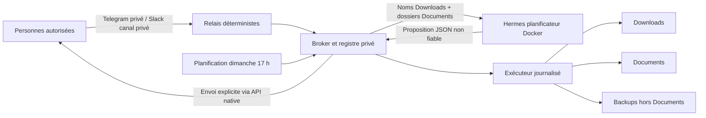

# Spécifications techniques — Père-Blaise

Version de cadrage : 14 octobre 2026. Phase de conception uniquement. Les valeurs ci-dessous sont des contrats de développement, non la description d'un runtime validé.

## 1. Références et état de départ

Consignes applicables : [`../AGENTS.md`](../AGENTS.md), [`../docs/agent-creation-checklist.md`](../docs/agent-creation-checklist.md), [`../README.md`](../README.md). Sources existantes de l'agent : [`README.md`](README.md), [`TODO.md`](TODO.md), [`docs/policy.md`](docs/policy.md), [`docs/access-matrix.md`](docs/access-matrix.md), [`docs/runbook.md`](docs/runbook.md), [`docs/operations.md`](docs/operations.md), `src/pere_blaise/{workflow,planning,store,scanner,router,file_delivery,telegram_gateway,slack_gateway,weekly_analysis}.py`, `scripts/apply-organize-plan-v2.py`, `config/planner.config.yaml`, `infra/docker/docker-compose.planner.yml`, `infra/slack/app-manifest.json`, `tests/test_contracts.py`. Aucun `AGENTS.md` propre à `pere-blaise/` n'a été trouvé.

Référence Hermes locale consultée : dépôt `/Users/clement/workspace/hermes-agent`, révision Git `bd0affe5e5f723579df8902852f5d0c47795f355`, `git describe` = `v0.21.4+canary.20261003T070620Z`. Documents : `README.md`, `website/docs/getting-started/installation.md`, `website/docs/user-guide/{docker.md,configuration.md,security.md,profiles.md,sessions.md}`, `website/docs/user-guide/messaging/{telegram.md,slack.md}`, `website/docs/user-guide/features/{api-server.md,tools.md,skills.md,memory.md,cron.md,hooks.md,mcp.md}`, `website/docs/reference/{toolsets-reference.md,mcp-config-reference.md}`, `website/docs/developer-guide/plugins/index.md`, ainsi que `docker-compose.yml` et les contrats `gateway/platforms/base.py`. Cette révision locale est une version **canary**, pas une preuve que l'image du projet contient la même révision. Le développement devra relever et figer digest et version réelle de l'image, puis tester toute interface utilisée. Les quotas du compte Codex, les identifiants Slack/Telegram et les permissions macOS ne sont pas accessibles depuis ces sources ; vérification à l'installation.

Écarts avérés de la première version : plan à 12 h au lieu de 30 min (`broker.py`, `store.py`) ; analyse dimanche 18 h au lieu de 17 h (`README.md`, `docs/operations.md`) ; seul Telegram sait envoyer un fichier (`file_delivery.py`, `infra/slack/README.md`) ; exécuteur par actions sans rollback de tout le plan (`apply-organize-plan-v2.py`) ; cible de quarantaine plutôt qu'un backup conservé hors `Documents` ; création possible des parents de cible ; confiance actuelle limitée à `low`/`medium` et incohérente avec les seuils voulus (`workflow.py`) ; recherche portant sur le chemin et plafonnée à cinq correspondances. Le code et la documentation ne sont pas réputés fonctionnels ; réutiliser uniquement après tests et adaptation.

## 2. Architecture cible et choix Docker

Hermes **s'exécute dans Docker** : projet Compose `hermes-pere-blaise`, service Compose `pere-blaise`, conteneur `hermes-pere-blaise`, runtime et OAuth privés sur un volume Docker natif `hermes-pere-blaise-data`. Il expose son API de planification uniquement sur le réseau interne Compose, protégée par une clé interne. Il n'a aucun montage de `Downloads`, `Documents` ou backups, aucun token Slack/Telegram, aucun outil de fichiers/terminal/navigateur. Il reçoit un inventaire textuel réduit et renvoie une proposition JSON non fiable.

Un service applicatif isolé `broker` (conteneur `hermes-pere-blaise-broker`) possède les trois montages stricts : `Downloads`, `Documents`, backups, ainsi qu'un volume d'état privé. Il héberge le routeur déterministe, le scanner, le registre SQLite des plans et apprentissages, l'exécuteur auditable et les relais Telegram/Slack. Les relais utilisent les API/SDK natifs des plateformes pour les messages et pièces jointes. Telegram fonctionne en polling privé et Slack en Socket Mode, sans port entrant public. Une seule instance consomme chaque bot. Les secrets de canaux restent dans ce service, séparés du volume Hermes. Un réseau interne relie ce service à l'API Hermes ; les sorties Internet sont bornées aux domaines des deux plateformes et du fournisseur dans le conteneur concerné, avec preuve de configuration/résolution et refus des autres accès lorsque l'environnement le permet.

**Docker comme backend d'exécution des outils Hermes** (`terminal.backend: docker`) n'est pas retenu : aucun terminal ni `execute_code` n'est nécessaire au planificateur, et ce backend monterait des skills/credentials supplémentaires dans un conteneur d'outils. Ce choix est distinct du conteneur qui exécute Hermes. L'architecture garde le dépôt projet séparé du cœur Hermes, sans patch de celui-ci.

La séparation de confiance est stricte : les noms de fichiers sont des **données non fiables**, jamais des instructions ; la sortie LLM n'accorde aucun droit. Le broker reconstruit un manifeste canonique depuis son propre inventaire et refuse source inconnue, chemin absolu, `..`, lien symbolique, dossier cible inexistant, doublon ou collision. Le seul appel privilégié est `range` lié à une identité authentifiée et à un plan enregistré. Le service applicatif ne propose aucune interface d'exécution de commandes arbitraires.

## 3. Capacités Hermes : examen et décision

| Capacité | Usage concret / décision | Prérequis, limites et configuration | Preuve |
| --- | --- | --- | --- |
| Fournisseur `openai-codex` | Planifier les cibles à partir des métadonnées minimales. | `model.provider: openai-codex`, modèle approuvé au déploiement (base existante `gpt-5.4`, à confirmer sur la révision/image et le compte), OAuth privé ; pas d'API key ni fallback implicite. | Réponse JSON structurée et erreur de quota sans déplacement. |
| API serveur Hermes | Frontière de planification interne, déjà amorcée dans le dépôt. | API activée, clé interne privée, réseau Compose sans publication publique ; valider l'endpoint et les garanties exactes du digest retenu. | Appel autorisé et refus sans clé/hors réseau. |
| Canaux Hermes Telegram/Slack | Évalués mais **non activés** dans Hermes pour ce cas. | Leur livraison native de fichier exige que le gateway puisse lire le chemin local ; cela donnerait les octets à l'environnement de planification. Les relais du service applicatif utilisent les mêmes API natives sous contrôle déterministe. Tester polling unique et Socket Mode. | Envoi réel des deux canaux, aucun montage bibliothèque sur Hermes. |
| Toolsets et outils Hermes | `platform_toolsets.api_server: []` et désactivation globale des outils non utiles ; sortie texte/JSON seulement. | Vérifier sur l'image qu'aucun terminal, fichier, navigateur, web, MCP externe, code, cron, délégation ou `send_message` n'est exposé à la session API ; les gardes de prompt seuls ne suffisent pas. | Introspection de session et tentatives refusées. |
| Skill `pere-blaise` | Procédure versionnée de classement, critères et discipline de données. | Le skill explique, ne constitue jamais une frontière de sécurité ; chargement à nouvelle session après changement. | Relecture du prompt, test de classement et de refus. |
| Plugin/commande Hermes | Aucune modification cœur. Les slash commands de plugin sont documentées, mais leur handler reçoit surtout les arguments bruts : l'authentification et l'envoi déterministes restent au broker. | N'ajouter un plugin autonome que si une API publique stable apporte un besoin démontré après test ; sinon maintenir les relais existants. | Absence de plugin inutile et validation de provenance d'identité. |
| MCP | Non activé : un serveur MCP offrirait au modèle des outils plus larges alors que le broker suffit. | Réévaluer seulement si une interface standard strictement typée devient nécessaire ; `include` exhaustif et tests de permissions alors obligatoires. | Aucun serveur MCP configuré. |
| Mémoire Hermes | Exception existante conservée : mémoire libre et profil utilisateur désactivés ; SQLite local spécialisé. | `memory.memory_enabled: false`, `user_profile_enabled: false` ; approbation de l'exception déjà documentée dans `TODO.md`/`docs/policy.md`, à reconfirmer à la revue finale. Les données suivent `F-013/014`. | Aucune mémorisation libre, apprentissage récupéré après redémarrage. |
| Recherche de sessions / profils | Recherche de sessions désactivée ; un seul `HERMES_HOME` privé dédié à Père-Blaise. | Les transcriptions peuvent contenir des noms sensibles ; aucun profil partagé ou gateway multiplexé avec un autre agent. | Isolation du volume et test inter-agent. |
| Sous-agents / délégation | Aucun usage. | Toolset absent. | Demande de délégation impossible. |
| Cron Hermes | Mécanisme évalué, notamment `no_agent`, mais non activé : la tâche est portée par un ordonnanceur déterministe du broker afin de notifier deux canaux **avant** un unique appel de planification, sans donner à Hermes un outil ou endpoint de déclenchement supplémentaire. | Une tâche persistée, créée en pause, fuseau `Europe/Paris`, clé d'idempotence par semaine, timeout et coût maximal configurés ; le broker envoie « démarrage » avant l'analyse, puis résultat aux deux canaux. Aucune exécution de rattrapage automatique après une heure manquée : un incident est signalé au prochain démarrage. | Test manuel puis activation documentée ; simulation DST et redémarrage. |
| Hooks / interfaces desktop | Non activés : aucun événement Hermes ni UI supplémentaire ne sert la mission. | Les hooks chargent du code avec les droits du gateway, donc augmenteraient la surface ; l'interface reste les deux canaux. | Configuration et liste de hooks vides. |

## 4. Matrice besoin → capacité → solution → validation

| Exigences | Capacité Hermes / extension | Justification | Test |
| --- | --- | --- | --- |
| F-001, F-003, F-004, F-005 | Relais déterministes + SQLite transactionnel | Identité vérifiée avant toute donnée ; ID non secret. | R3, R10, concurrence et canal croisé. |
| F-002 | API Hermes à toolsets vides + scanner réduit | LLM propose ; broker décide la validité. | R2, absence de mutation et refus JSON invalide. |
| F-006, F-007, F-008, F-009, F-010 | Exécuteur versionné, journal et montages bornés | Transactions de fichiers hors contrôle LLM. | R2, R4, R5, test permissions négatives. |
| F-011, F-012 | Recherche locale + API native Telegram/Slack | Désambiguïsation et transfert seulement après demande. | R1, test fichier volumineux, symlink et limite. |
| F-013, F-014 | SQLite spécialisé local | Hash et preuves d'origine ne tiennent pas dans mémoire textuelle Hermes. | R6, purge et restauration. |
| F-015 | Ordonnanceur à déclencheur unique du broker | Deux notifications, une seule analyse. | R9 et panne d'un canal. |
| F-016 | Journal structuré commun | Diagnostic sans fuite dans les messages. | Injection de chaque famille d'erreur. |
| F-017 | Volumes privés + sauvegarde cohérente | Reprise après coupure et changement d'image. | R5, R8. |
| F-018 | Bot/app existants réutilisés | Pas de doublon ni perte de configuration. | E2E réel Telegram/Slack. |

## 5. Contrats des modules et données

### 5.1 Configuration et identités

Configuration versionnée sans secrets : racines **paramétrées** de `Downloads`, `Documents`, backup ; limites de taille/fichiers/durée ; modèle ; fuseau ; politiques de rétention ; IDs de canaux de **test** fictifs uniquement. Configuration privée : mapping `(telegram,user_id)` / `(slack,user_id)` vers un identifiant de personne stable, vérifié manuellement par l'exploitant ; allowlists par canal et rôle ; tokens et clé API interne. Aucun compte ne s'auto-associe à un autre canal. La provenance plateforme fait partie de chaque requête ; aucune identité transmise par le texte de la commande n'est acceptée.

Le bot Telegram existant n'est ni supprimé ni recréé par le script. Révoquer son token seulement s'il a fui ou si le processus précédent ne peut être arrêté. L'app Slack existante est conservée si elle appartient au bon workspace et canal ; ajouter le scope minimal `files:write` (et les scopes de lecture/Socket Mode effectivement exigés par la version testée), puis réinstaller si Slack l'exige. Aucun DM ni autre canal. Tester un seul consommateur Telegram avant activation.

### 5.2 Inventaire et plan

`scan()` reçoit des racines canoniques fixées par config, retourne fichiers réguliers visibles de `Downloads` (chemin relatif, nom, taille, mtime, identité de fichier ; hash local séparé), dossiers existants de `Documents` et inventaire local de cibles occupées. Il ne suit aucun symlink, y compris ceux présents dans un parent. Le modèle ne voit ni hash, ni identité OS, ni noms de documents classés. Nombre et taille sont plafonnés par configuration ; dépasser une limite refuse l'analyse avec code, sans troncature invisible. Si `Documents/a_trier` manque, le plan peut le désigner, mais aucun autre répertoire absent n'est une cible exécutable. Les propositions de nouveaux sous-dossiers sont de simples notes dans `détaille`.

`plan_proposal` est un JSON d'actions `{source_relative,destination_relative,reason,certainty}`. Le broker vérifie cardinalité : exactement une action par fichier éligible, noms préservés, aucune source inconnue ni cible existante ; il normalise Unicode (NFC) et teste les collisions selon les règles du volume macOS (casse/normalisation). Il ne persiste une confiance générale qu'après calcul local de `A/N` selon les règles fonctionnelles. La justification par fichier doit être rédigée sans mentionner le contenu et validée comme texte non exécutable ; toute justification absente ou incohérente force une nouvelle proposition bornée puis une erreur. Un inventaire signé/canonique et sa génération de dossiers sont conservés avec le plan. Au maximum un plan proposé globalement ; création d'un nouveau plan invalide atomiquement l'ancien.

À `range`, verrou interprocessus, transaction de revendication du plan, contrôle de l'auteur, expiration à l'horloge monotone ou UTC persistée, comparaison du snapshot de `Downloads` et des dossiers de `Documents`, revalidation de chaque source et destination et de l'espace disque. Les événements de filesystem peuvent accélérer l'invalidation, mais **un rescan obligatoire à l'exécution** garantit la règle après redémarrage ou événement perdu. Une modification silencieuse du contenu d'une source refuse l'exécution via empreinte locale. Si le plan est issu du cron, son auteur est le propriétaire configuré de la tâche, non une identité anonyme ; seul ce propriétaire peut le détailler/ranger.

### 5.3 Exécuteur et rollback

Entrée : uniquement un manifeste immuable issu du registre, son ID et une autorisation interne à usage unique ; jamais de chemins libres depuis le chat ou le LLM. Sortie : état `applied`, `rolled_back`, `blocked_recovery` ou `rejected`, code, ID d'incident, résultats par action et chemins de backup relatifs. Les opérations sont idempotentes au niveau de l'ID de plan.

Séquence : (1) précontrôles de tous les fichiers, chemins, collisions, montages, permissions, quota et espace pour **backup complet plus transfert** ; (2) journal durable `PREPARING` ; (3) copies des sources vers `backup/<plan-id>/...` avec création exclusive, `fsync`, vérification hash et manifeste de backup ; (4) journal `BACKUPS_VERIFIED` ; (5) déplacements vers des cibles nouvelles, journal par action et `fsync` des fichiers et dossiers selon support du volume ; (6) validation de toutes les destinations et état `APPLIED`. Aucun overwrite. L'implémentation peut utiliser copie+retrait de la source si les points de montage Docker rendent `rename` inter-montages impossible ; le retrait est exclusivement la partie autorisée du déplacement d'un fichier `Downloads`. Ne jamais supprimer un fichier préexistant de `Documents`. Une opération de rollback peut retirer uniquement les cibles qu'elle vient de créer, après preuve de leur identité, puis restaurer les sources depuis les backups. Les backups persistent dans tous les états.

L'atomicité parfaite de plusieurs fichiers sur plusieurs montages, surtout après coupure électrique, n'est pas disponible sur macOS/Docker. Le contrat utilisateur est une **transaction récupérable** : au redémarrage, une phase de récupération lit le journal avant d'accepter un nouveau plan et termine le rollback si les preuves correspondent ; en cas de modification concurrente, elle s'arrête sans écraser et exige une intervention manuelle. Le message distingue toujours `rolled_back` de `blocked_recovery`. Les tests provoquent erreurs de copie, disque plein, arrêt après chaque phase et intervention concurrente.

### 5.4 Recherche/envoi et apprentissage

`search(query, requester)` cherche sur le **basename** normalisé uniquement, exhaustivement dans `Documents/**`, retourne une liste stable de chemins relatifs et un token de sélection lié à l'identité et à l'état du fichier. Des résultats trop nombreux sont paginés **sans masquer le total**, et aucune pièce jointe n'est émise avant choix non ambigu. `send(selection)` revalide chemin/identité, interdit symlinks et dépassement de limite, ouvre le fichier sans le fournir au LLM et l'envoie par API native du canal d'origine. Le résultat de l'API constitue la preuve de livraison ; timeout ambigu = état `delivery_uncertain`, aucune répétition automatique risquant un doublon.

`track_a_trier` est inscrit uniquement après un `range` réussi. Empreinte SHA-256 du fichier d'origine et identité/stat sont conservées dans SQLite privé. `reconcile` au lancement d'une analyse ou de `apprentissages` repère la disparition de `a_trier`, restreint les candidats par métadonnées, calcule localement leurs hashes seulement si nécessaire et accepte **un seul** appariement hors `a_trier`. Un doublon de contenu, une édition du contenu ou une sortie de `Documents` garde l'état `ambiguous/missing`, sans enseignement. Une observation confirmée lie caractéristiques du nom d'origine à un dossier existant, jamais à une instruction de déplacement autonome. Consultation, correction et effacement sont des opérations déterministes soumises à l'identité de l'exploitant ; le texte de procédure doit être documenté et testé. La base est sauvegardée par l'API SQLite de backup, pas copiée à chaud à l'aveugle.

## 6. Permissions et secrets

| Ressource | Hermes | Service applicatif / identité | Refus à tester |
| --- | --- | --- | --- |
| `Downloads` | Aucun montage | Métadonnées ; lecture d'octets pour hash/copie ; déplacement source autorisé | Hors racine, symlink, fichier spécial, retrait arbitraire |
| `Documents` | Aucun montage | Métadonnées/recherche ; lecture d'octets seulement pour hash candidat et envoi ; nouvelle cible de plan | Lecture de contenu par LLM, modification/suppression d'existant, dossier créé hors `a_trier` |
| Backups | Aucun montage | Création et vérification ; lecture de restauration ; aucune purge automatique | Accès à un autre chemin ou par le modèle |
| Volumes d'état | Volume Hermes dédié | Volume broker distinct, SQLite/journal/logs | Montage partagé entre agents ou publication réseau |
| Réseau | Fournisseur OpenAI + API interne | Telegram, Slack + API interne ; aucun port public | Egress non nécessaire, API sans clé, autre canal |
| Secrets | OAuth Codex dans volume privé | Tokens Telegram/Slack et clé interne dans fichiers/secret store privés | Impression/log/commit/montage croisé |

Compose : conteneurs non privilégiés, sans socket Docker, sans montage de `$HOME`, dépôt entier ou racine système ; `no-new-privileges`, limites CPU/RAM/PID, réseau interne, healthchecks réels. Seuls les répertoires métier résolus sont bind-montés dans le service applicatif. `Downloads` et `Documents` exigent un montage en écriture pour la sémantique de déplacement, mais le point d'entrée du service n'expose aucune commande libre ; l'interdiction de toucher l'existant repose aussi sur validation de chemins, identité et tests. Le système de fichiers racine du service applicatif est en lecture seule avec volumes/tmpfs spécifiques **si compatible après test**. L'image Hermes actuelle du dépôt signale des besoins d'initialisation s6 : ne pas supposer `cap_drop: ALL`, utilisateur non-root au PID 1 ou racine read-only sans essai de démarrage. Le processus Hermes final doit tourner avec l'identité non privilégiée fournie par l'image.

Sur Docker Desktop macOS, `state.db` Hermes en WAL **ne doit pas** être sur un bind mount virtiofs : la documentation Hermes (`website/docs/user-guide/docker.md`, §Filesystem requirements) avertit d'une corruption silencieuse avec writers concurrents. Utiliser le volume nommé natif `hermes-pere-blaise-data`, propre à cet agent. Si un ancien `state.db` WAL est sur bind mount, arrêter tous les processus puis convertir hors ligne en journal `DELETE` ou migrer vers le volume natif ; ne jamais convertir à chaud. La base SQLite du broker est aussi sur son propre volume natif, avec sauvegarde cohérente. Les dossiers utilisateurs sur macOS nécessitent les autorisations Docker Desktop de partage de fichiers et les autorisations macOS du propriétaire ; le démarrage échoue clairement si l'accès réel manque.

Provisionnement : aucun token réel dans Git, exemples ou sorties de commande. Les secrets sont saisis dans un gestionnaire de secrets ou des fichiers locaux 0600 sous un dossier privé 0700 ; montage ciblé en lecture seule quand possible, OAuth initialisé dans le volume Hermes privé. Le runbook décrit renouvellement OAuth, rotation/révocation des deux tokens et de la clé interne, test de reconnexion et sauvegarde chiffrée hors dépôt. Aucun fournisseur de repli automatique. Les identifiants de canaux sont des données de configuration privée, même s'ils ne sont pas des clés.

## 7. Structure prévue et cycle de vie

Conserver `pere-blaise/` comme source unique : `README.md`, `POLICY.md` ou `docs/policy.md`, `ACCESS-MATRIX.md` ou `docs/access-matrix.md`, `compose.yaml`, `config/` sans secrets, `prompts/`, `skills/pere-blaise/`, `src/pere_blaise/` (domaines `inventory`, `plans`, `executor`, `delivery`, `learning`, `channels`, `scheduler`), `contracts/` (schémas des manifestes et réponses), `scripts/` (cycle de vie et migrations), `tests/` (unitaires, intégration, Docker, recette), `docs/` (installation, exploitation, sauvegarde, restauration). Retirer les doublons documentaires **pendant le développement** avec redirections claires ; ne pas modifier les guidelines dans cette phase de spécification.

Contrats CLI des scripts de cycle de vie, sous `scripts/`, sans variable de chemin implicite ni commande récursive non prévisualisée :

| Commande prévue | Contrat |
| --- | --- |
| `install --dry-run` puis `install` | Résout et affiche source/destination physiques, tailles et budget ; vérifie slug, périmètre, absence de symlink suivi ; copie uniquement source versionnée vers staging, teste, puis active sans écraser le runtime actif. Respecte l'`AGENTS.md` ; aucune suppression. |
| `configure` | Crée la configuration privée et des emplacements de secrets avec permissions strictes, vérifie les trois racines et les IDs/allowlists ; ne montre jamais la valeur d'un secret. |
| `start` | Vérifie Docker Desktop, volumes, auth, permissions et absence d'autre bot ; démarre services, attend healthchecks ; cron demeure désactivé jusqu'au test/accord. |
| `stop` / `restart` | Arrêt gracieux, journal de transaction fermé ou reprise requise ; redémarrage idempotent, aucun `range` répété. |
| `status` / `logs` | Santé par service, job et transaction ; logs filtrés par ID d'incident, secrets masqués. |
| `update --dry-run` puis `update` | Image par digest, migration de schéma versionnée, backup cohérent préalable, staging, smoke tests, bascule ; rollback du code/digest et de la base si compatible. |
| `backup` / `restore --dry-run` puis `restore` | Sauvegarde SQLite via API cohérente, volumes Hermes/export, configuration et secrets chiffrés ; manifeste de version et checksums ; restauration hors ligne, permissions, intégrité, smoke test. Les backups de fichiers classés sont inventoriés séparément et conservés. |
| `uninstall --dry-run` puis `uninstall` | Arrête et retire services/LaunchAgents éventuels et déploiement applicatif **sans effacer données, backups, volumes ni secrets** ; affiche chemins et tailles. Toute suppression d'ancien déploiement suit la validation explicite d'`AGENTS.md`. |
| `purge --dry-run` puis `purge` | Commande distincte de suppression complète : affiche précisément code déployé, volumes Hermes/broker, logs, config, secrets et backups visés, avec chemins et tailles ; exige confirmation explicite après aperçu. Aucun glob, racine ou ressource hors slug ; ne touche jamais `Downloads` ni `Documents`. |

Les scripts shell appliquent `set -euo pipefail` et échouent si une variable critique est vide. Une source de déploiement hors `~/workspace/my-hermes/<slug>` est **refusée par la convention actuelle** ; ce dépôt est sous `~/workspace/hermes-knights-grail/pere-blaise`, donc le flux de déploiement ne sera utilisable ici qu'après décision sur la modification de guideline proposée au §10 ou après placement d'une source conforme. Ne pas contourner par une copie non contrôlée. Le développement peut créer/tester localement sans déployer tant que ce point reste ouvert ; le prompt demande de traiter ce blocage honnêtement.

La migration applique une version de schéma, conserve une exportation avant changement et teste le chemin de retour. Un journal en état `APPLYING` empêche l'upgrade. Une mise à jour de skill/prompt/toolset prend effet à une nouvelle session ou après redémarrage contrôlé. Pas de partage de volume ou d'OAuth avec les autres agents.

## 8. Tests et preuves exigées

Chaque test utilise des arbres temporaires et des canaux de test, jamais les vrais `Downloads`/`Documents` en CI. Tests de propriétés de chemin (Unicode, casse, `..`, symlink et TOCTOU), calcul exact des seuils à 0, 19,99 et 20 %, expiration 30 min, invalidations, auteur cross-canal, collisions, restauration après chaque phase du journal, espace insuffisant et vérification des backups. Les intégrations utilisent de vrais répertoires montés sous Docker Desktop macOS pour vérifier les sémantiques `rename`/copie, fsync et permissions. Tests E2E avec bot/app réels de test pour mention/fil, envoi d'un fichier, refus d'un tiers, échec de connecteur et idempotence. Vérifier les limites de taille natives sur les deux plateformes. `docker compose config`, démarrage, healthchecks, volume SQLite natif, absence de montages non autorisés, accès refusé hors racines et absence d'outils Hermes inutiles sont des portes de recette.

La table du §4 relie chaque F-001…F-018 à une preuve ; le développement maintient un tableau F-ID → fichier(s) → test(s) → résultat. Les scénarios R1…R10 des spécifications fonctionnelles constituent la recette locale. Les tests réels demandant compte, Docker Desktop ou permissions non disponibles doivent être listés avec commande, prérequis et résultat « non vérifié », jamais annoncés comme réussis.

## 9. Risques, limites et décisions de déploiement

- L'identification par hash exige une lecture locale des candidats ; la taille et le nombre de candidats sont bornés, et un contenu modifié ou un doublon exact interdit l'apprentissage automatique.
- Les noms de fichiers `Downloads` et dossiers `Documents` partent vers OpenAI via l'abonnement Codex, conformément à l'accord ; logs et sessions Hermes doivent éviter de stocker davantage que nécessaire, avec rétention et effacement documentés.
- Un rollback après panne matérielle n'est pas instantané : le journal réconcilie avant de nouvelles commandes, sinon `PB-ROLLBACK-BLOCKED` impose une intervention humaine. Les backups restent la source de restauration.
- Les API Slack/Telegram et leurs quotas, l'accès Docker Desktop aux répertoires macOS et l'éligibilité du modèle à l'automatisation/volume sont des dépendances à vérifier avant activation.
- Les identifiants réels des personnes et des canaux, chemins physiques, capacité disque et limites de taille sont fournis **au paramétrage**, sans nécessiter de changement de logique. Les valeurs de conservation du §7 fonctionnel sont des défauts révisables.

## 10. Modifications proposées aux guidelines

Ces propositions ne modifient aucun fichier de guideline à cette étape et ne sont **pas approuvées** implicitement. Le prompt de développement ne les applique que si l'utilisateur les approuve explicitement ; sinon il respecte les règles actuelles et indique tout blocage de déploiement.

| Fichier | Texte/règle proposé(e) | Raison concrète | Effet |
| --- | --- | --- | --- |
| `../AGENTS.md`, section « Déploiements locaux » et `../docs/agent-creation-checklist.md`, §2 | « Une source située sous `~/workspace/<nom-de-depot>/<slug>` est autorisée si `<nom-de-depot>` figure dans une liste approuvée, si le slug et les fichiers attendus sont vérifiés, et si toutes les autres vérifications physiques, budgets, staging et validations de suppression sont conservées. » Ajouter `hermes-knights-grail` à la liste approuvée pour cet agent seulement. | La règle actuelle impose `~/workspace/my-hermes/<slug>`, alors que le projet réel est `~/workspace/hermes-knights-grail/pere-blaise`. | Permettre un installateur conforme depuis ce dépôt sans symlink/copie de contournement ; sécurité du dry-run inchangée. |
| `../AGENTS.md`, section « Permissions et isolation » et checklist §6 | « Pour un agent qui déplace des fichiers, les montages source/cible en écriture sont autorisés uniquement dans un composant exécuteur isolé, à interface typée, avec journal et test de refus ; le LLM ne reçoit aucun montage. Un backup externe est une troisième racine de données réservée à cet exécuteur. » | Les règles générales « entrées en lecture seule » et « accès aux deux répertoires » doivent distinguer planificateur et exécuteur pour cette mission. | Rend la matrice d'accès et les tests vérifiables sans élargir les permissions Hermes. |

La politique et le README propres à Père-Blaise devront, pendant le développement, être **alignés** sur les décisions approuvées ici (30 min, 17 h, backup, envoi Slack, rollback, confiance) ; il s'agit de documentation d'agent, pas d'une modification de la convention commune.
