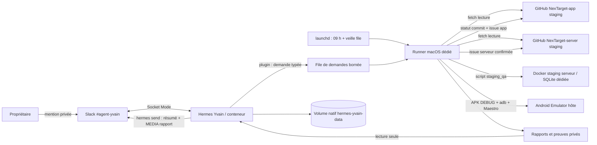

# Yvain — spécifications techniques

Décisions : 26–27 octobre 2026. La réalisation porte sur `yvain/` dans `hermes-knights-grail` ; ce document ne déploie rien.

## 1. Références vérifiées et limites de version

Consignes applicables : `AGENTS.md` à la racine du présent dépôt et `docs/agent-creation-checklist.md`. État actuel examiné : `yvain/README.md`, `TODO.md`, `compose.yaml`, `config/config.yaml`, `config/runner.env.example`, `prompts/system.md`, `runtime/yvain-policy.md`, `skills/yvain/SKILL.md`, `qa/manifest.json`, `qa/coverage.md`, `scripts/run-recipe.sh`, `scripts/select_cases.py`, `scripts/run-android-staging.sh`, `scripts/ensure_emulator.sh` et `tests/test_run_android_staging.sh`. Le dépôt projet était propre au commit `4f2b3b381ecd100d93e41aadafb5d49da4c0ca36` au début de l'analyse.

Sources produit lues : `NexTarget/AGENTS.md`, `NexTarget-app/AGENTS.md`, `NexTarget-app/docs/tests/README.md`, `docs/tests/cahier_recette.yaml` (`version: v0.9`, 55 IDs lors de l'inspection), son `.md` généré, `docs/qa/README.md`, `docs/tech/serveur_local_emulateur_android.md`, ainsi que `NexTarget-server/AGENTS.md`, `README.md`, `docs/guides/staging-qa.md`, `docker-compose.staging.yml`, `scripts/staging_qa.sh` et `.env.staging.example`. Le checkout app était `dev` à `715ae0cd00770430c894d503e62f63e974510fbf` ; le checkout serveur était `feature/NT-168-staging-qa` à `c25d541a0ee9e9111fa6bdf6edf26dea872de9bb`. Les branches distantes nommées exactement `staging` n'existaient pas dans ces deux dépôts le 26 octobre 2026 ; le propriétaire les créera.

Référence Hermes : checkout local `/Users/clement/workspace/hermes-agent`, commit `bd0affe5e5f723579df8902852f5d0c47795f355` (description Git `v0.21.4+canary.20261003T070620Z`). Le checkout porte des modifications locales **hors documentation consultée** ; la référence normative ici est le contenu des fichiers de documentation à ce commit. La version réellement contenue dans l'image Docker Yvain épinglée par digest **n'a pas été vérifiée en exécution** : le développement devra comparer ses commandes et APIs à l'image retenue, pinner un digest testé et documenter tout écart. `pyproject.toml` affiche `0.0.0`, qui n'est pas une version de déploiement exploitable.

| Domaine Hermes | Sources consultées et conclusion utilisée |
| --- | --- |
| Installation, image, Docker, SQLite | `website/docs/getting-started/installation.md`, `website/docs/user-guide/docker.md` : image stateless, volume `/opt/data`, base `state.db` ; sur Docker Desktop macOS, préférer un **volume Docker natif** pour SQLite en WAL. |
| Configuration, modèle, sécurité | `website/docs/user-guide/configuration.md`, `website/docs/integrations/providers.md`, `website/docs/user-guide/security.md` : `openai-codex` via OAuth Hermes, toolsets par plateforme, allowlists, approbations et racine d'écriture. Les limites exactes de plan/quota Codex ne sont pas documentées dans le checkout : pré-vol réel obligatoire. |
| Gateway et Slack | `website/docs/user-guide/messaging/slack.md`, `website/docs/user-guide/messaging/webhooks.md` : Slack Socket Mode, canal/identités autorisés, pièces jointes natives via `MEDIA:<path>`, webhook signé disponible mais non retenu pour le déclenchement quotidien. |
| Outils et extensions | `website/docs/reference/toolsets-reference.md`, `website/docs/reference/tools-reference.md`, `website/docs/user-guide/features/tools.md`, `website/docs/developer-guide/tools-runtime.md`, `website/docs/user-guide/features/skills.md`, `website/docs/user-guide/features/plugins.md`, `website/docs/developer-guide/plugins/index.md`, `website/docs/user-guide/features/mcp.md` : toolsets limités ; plugin local autonome pour une demande de run à schéma fixe ; aucune modification du cœur. |
| État et automatisation | `website/docs/user-guide/features/memory.md`, `website/docs/user-guide/sessions.md`, `website/docs/user-guide/profiles.md`, `website/docs/user-guide/features/cron.md`, `website/docs/guides/automate-with-cron.md`, `website/docs/user-guide/features/hooks.md`, `website/docs/guides/pipe-script-output.md` et `hermes_cli/send_cmd.py` : mémoire et sessions privées ; planification Hermes, hooks et sous-agents examinés, non nécessaires au pilotage du runner macOS ; `hermes send` accepte `MEDIA:` pour l'envoi de rapport. |

Référence GitHub pour la nouvelle autorisation d'issues : [GitHub REST — Create an issue](https://docs.github.com/en/rest/issues/issues#create-an-issue), qui exige la permission de dépôt `Issues: write` pour un jeton finement limité. Le contrat ci-dessous borne cette écriture aux dépôts NexTarget-app et NexTarget-server ; aucun droit de modification du code n'est accordé.

## 2. Architecture retenue et frontières de confiance

Hermes **s'exécute dans Docker** pour Slack, ses sessions, sa mémoire et son identité. Le backend `terminal.backend: docker` est un autre mécanisme qui met seulement les commandes d'un Hermes hôte dans un conteneur ; il n'est pas choisi. Ni ce backend ni un conteneur Linux sous Docker Desktop ne sont un support fiable pour Android Emulator sur macOS. Flutter, AVD, `adb`, Maestro et le contrôle de Docker Desktop restent sur le Mac, sous un compte local dédié. Le conteneur Hermes ne reçoit jamais le socket Docker ni un accès terminal à l'hôte.

Frontières : (1) messages Slack et commits sont non fiables ; le plugin n'accepte qu'une opération `full_recipe`, aucun chemin, branche ou shell libre ; (2) le runner hôte valide lui-même la demande, les refs et les chemins physiques ; (3) le serveur de staging et l'AVD sont des ressources **dédiées** qu'il est autorisé à réinitialiser ; (4) le rapport est une donnée d'observation, jamais une instruction ; (5) les secrets Slack/OAuth vivent dans le seul runtime Hermes, le jeton GitHub dans un magasin privé hôte, le JWT staging dans `.env.staging` privé du serveur ; aucun n'entre dans l'APK, le rapport ou une issue GitHub. L'écriture GitHub est limitée aux statuts du dépôt app et aux issues des deux dépôts autorisés.

### Composants et flux précis

1. Un LaunchAgent utilisateur, installé désactivé, vérifie quotidiennement les deux `origin/staging` à 09 h `Europe/Paris` et rattrape un passage manqué au réveil. Un contrôle léger des demandes Slack s'exécute au plus chaque minute ; il ne fait pas de `git fetch` hors contrôle quotidien ou demande manuelle. Le journal d'état contient `last_checked_pair`, `last_recipe_pair`, `pending_latest_pair`, horodatages, verdict/rapport du dernier run et identifiants de demande. Un verrou de processus atomique empêche deux runs. Les pushes intermédiaires sont listés par dépôt entre la paire précédente et la paire courante ; seule la dernière paire est recettée.
2. Le plugin Hermes `yvain-request` enregistre `request_yvain_recipe` et, éventuellement, une commande `/recette`. L'allowlist gateway contrôle l'identifiant Slack et le canal privé ; l'extension revérifie ces métadonnées si l'API de l'image les expose. Sinon, elle utilise le handler Slack public à métadonnées natives pour une commande explicite, plutôt que de faire confiance à un identifiant fourni par le modèle. Elle n'admet que l'opération `full_recipe`, puis écrit atomiquement une demande JSON avec UUID, origine `manual`, date et TTL dans une file de volume montée à part. Elle ne lance aucun processus hôte. Le runner revalide la forme, l'âge, l'absence de symlink et l'idempotence, puis accuse réception dans son état. Les entrées libres des messages Slack ne deviennent jamais des arguments shell.
3. Pour les deux types de contrôle, le runner `git fetch` les deux branches `origin/staging` et compare atomiquement la paire `(SHA app, SHA serveur)` à `last_recipe_pair` **avant tout lancement de campagne, build, reset ou statut GitHub**. Si les deux SHA sont identiques, il consigne `unchanged` sans campagne ; pour une demande Slack, il renvoie le dernier run, verdict et chemin de rapport au plugin, qui répond dans le fil sans renvoyer la pièce jointe et indique si le rapport a expiré. Si l'un des SHA diffère ou si `last_recipe_pair` est absent, il réserve la paire comme campagne engagée dans l'état durable, puis fige les SHA et construit l'app dans un worktree détaché **temporaire**. `last_recipe_pair` est conservé même si le verdict est `échoué`, `bloqué` ou `erreur` ; seul un run interrompu peut être repris sous son identifiant initial après redémarrage. Il valide le YAML et régénère le Markdown dans cet espace temporaire pour comparaison. Pour la première campagne, il fige aussi `origin/main` de l'app et sélectionne les `NT-XXX` des lignes ajoutées de `git diff <main_sha>...<app_staging_sha> -- CHANGELOG.md`, où `<main_sha>` et `<app_staging_sha>` sont les SHA figés de `origin/main` et `origin/staging` (soit la comparaison `origin/main...origin/staging` sans dépendre du déplacement ultérieur des refs). Pour les suivantes, la base du diff est le précédent SHA app recetté et la tête est le SHA app staging courant. Les IDs sont dédupliqués, appariés au backlog et aux cas YAML ; ticket sans cas/oracle = blocage de couverture. L'ancien `qa/manifest.json` est une aide de migration, pas un moyen d'omettre des cas.
4. `NexTarget-server/scripts/staging_qa.sh up --branch staging` reconstruit depuis un worktree temporaire et réinitialise sa SQLite. Le projet Compose reste `nextarget-staging-yvain` (nom accepté par la validation du script), sur le port hôte `127.0.0.1:18000` réservé. Après chaque reset nécessaire, le runner vérifie `/ready` et `/health.revision`. `staging_qa.sh down` est **interdit** en arrêt normal car il exécute `down -v` et détruit le volume.
5. L'AVD unique est choisi par configuration privée. L'APK DEBUG porte l'URL `http://127.0.0.1:18000` et le SHA serveur ; `adb reverse` relie l'émulateur au port hôte. Le runner vérifie APK/SHA/hash, remet l'état Android à zéro entre cas, exécute Maestro et les assertions complémentaires, capture JUnit, captures, logcat filtré et preuves structurées. Il exécute d'abord tous les cas associés aux nouveaux tickets, confirme chaque échec fonctionnel après reset, puis calcule le verdict de phase. Si la sélection est vide ou si tous ses cas passent, il exécute tous les IDs du cahier, y compris les cas déjà testés ; sinon il marque la phase complète `non_exécuté`. Aucun cas n'est « réussi » seulement parce qu'un LLM juge une image plausible.
6. Le moteur de verdict déterministe crée `report.json` (schéma versionné) et `report.md` en français, avec une entrée finale par ID YAML et des résultats distincts par phase, y compris `non_exécuté` justifié, puis calcule le statut GitHub. Le moteur envoie un statut `Yvain/recette` sur le **SHA applicatif** avec l'identifiant du run et la phase atteinte en description ; pas de `target_url` vers un chemin local non accessible depuis GitHub. Pour chaque défaut fonctionnel reproduit deux fois, un client GitHub borné choisit le dépôt concerné d'après la preuve (app, serveur, ou app pour une intégration non attribuée), recherche une issue ouverte équivalente et crée une issue si elle n'existe pas. Le titre/corps mentionnent ticket, phase, deux SHA, étapes, attendu/observé et éléments expurgés ; aucune capture brute ou chemin local inaccessible n'est publié. Un identifiant de défaut et l'URL/numéro d'issue sont conservés pour les réessais idempotents. Les publications en échec restent dans une outbox durable ; après réponse ambiguë, relire GitHub avant de créer à nouveau. Si la création est encore en attente au moment du rapport Slack, marquer `issue_en_attente` et communiquer l'URL dans le fil dès sa publication, sans rejouer la recette.
7. La restitution utilise l'interface publique `hermes send --to slack:<channel-id>` depuis le conteneur, avec texte court et `MEDIA:/reports/<run-id>/report.md`. Le répertoire des rapports est monté en lecture seule dans Hermes et allowlisté par `gateway.media_delivery_allow_dirs`. La réponse réelle de l'API Slack est vérifiée, notamment l'upload ; un succès de message seul ne vaut pas succès de pièce jointe. Enregistrer de manière durable l'identifiant du fichier Slack, le bot créateur et la date d'envoi dans un registre de rétention distinct du rapport. À 30 jours, un outil borné supprime **uniquement ce fichier créé par Yvain** via l'interface Slack autorisée, vérifie le résultat et marque l'opération accomplie ; en cas d'échec, il alerte le propriétaire et réessaie sans rejouer les tests. La suppression d'un fichier de test doit réussir avant activation ; si l'image Hermes ne fournit pas cette opération, employer un petit client Slack autonome à droit minimal dans le runtime Yvain, sans modifier Hermes.

## 3. Besoin → capacité Hermes → mise en œuvre → preuve

| Besoin / exigences | Capacité Hermes | Configuration ou extension et raison | Validation |
| --- | --- | --- | --- |
| F-001, F-014, F-017 | Slack gateway + plugin, planification externe | Plugin de demande typée ; LaunchAgent hôte pour AVD/Docker ; comparaison persistante des deux SHA avant campagne. `cronjob` Hermes non activé : il tournerait dans le conteneur et exigerait le même pont hôte. | Contrôle 09 h et demande Slack : paire inchangée sans run, changement app ou serveur avec run ; doublon, verrou, arrêt/reprise. |
| F-002, F-003, F-004, F-016, F-021 | Skill Yvain + outil runner externe | Skill versionné explique les deux phases, le changelog, le cahier, les SHA et le backlog ; sélection et gate déterministes dans le runner, pas par mémoire LLM. | Diff initial `main...staging`, diff ultérieur depuis dernier SHA app, appariement, phase complète conditionnelle, 55 IDs ; branches absentes, YAML/MD divergents, nouveau NT sans cas. |
| F-005, F-006, F-007 | Aucune commande Hermes libre | Runner hôte allowlisté, `staging_qa.sh` public et Maestro ; Docker sert à **héberger Hermes et staging**, pas à héberger l'émulateur. | Intégration réelle AVD + Docker, preuve SHA et reset isolé. |
| F-008, F-010, F-011 | Prompts/skill pour interpréter ; verdict et publication déterministes | États structurés par phase dans `report.json`, sans inférence de succès ; client GitHub borné aux issues pour défaut produit confirmé. | Tous les états, échec répété avec issue app/serveur, instable sans issue, prérequis absent sans issue, absence de doublon. |
| F-009, F-018, F-019 | Sessions/mémoire Hermes + volume nommé | Volume `hermes-yvain-data` ; rapports/outbox privés hôte ; rétention et sauvegarde séparées. | Restart, restauration, purge à échéance, isolation d'un autre agent. |
| F-012 | Pas de connecteur Hermes requis | Appels GitHub Commit Status et Issues depuis le runner avec identité limitée ; le plugin GitHub de Codex n'est pas une dépendance runtime Hermes. | Statut sur SHA, issue sur dépôt concerné, permissions minimales, panne/reprise, refus d'écriture hors repo. |
| F-013, F-020 | Slack Socket Mode, `hermes send`, `MEDIA:` | Canal privé, allowlists, fichier `.md` depuis `/reports` ; pas de serveur HTTP public. | Mention autorisée/refusée, message + fichier réels, échec Slack. |
| F-015 | Toolsets et sécurité Hermes | Slack : `yvain_request`, `memory`, `session_search`, `clarify` ; accès en lecture à la procédure Yvain seulement si cela n'accorde pas sa modification. Aucun `terminal`, `browser`, `code_execution`, `delegation`, MCP ou outil GitHub générique. Hôte sous compte dédié ; seul le client GitHub borné peut créer une issue app/serveur. | Inventaire effectif des outils ; commandes, chemins et autres dépôts interdits refusés. |

| Capacité évaluée | Usage concret / décision | Prérequis, limite et configuration |
| --- | --- | --- |
| Canal Slack / gateway | Dialogue, demande manuelle, synthèse et rapport joint ; activé. | Socket Mode, bot/app tokens, canal privé et utilisateur en allowlist ; aucune écoute publique, panne traitée par outbox. |
| Connecteurs et MCP | Non activés : Git est lu par runner, GitHub Status/Issues par API bornée ; aucun serveur MCP existant ne couvre le Mac et l'AVD. | Un MCP futur exigerait serveur isolé, credentials filtrés, liste d'outils et test de refus ; ne pas installer un connecteur générique pour ces opérations fixées. |
| Outils et toolsets | Toolset du plugin de demande, `memory`, `session_search` et `clarify` pour Slack ; pas de terminal/navigateur/code générique. | Vérifier le résultat effectif de `platform_toolsets` sur l'image. Le toolset `skills` donne aussi `skill_manage` ; ne l'activer que si un contrôle technique éprouvé refuse toute modification de skill, sinon rendre la procédure Yvain lisible via un outil plugin en lecture seule ou le prompt versionné. |
| Skill Yvain | Procédure de lecture du cahier, interprétation du rapport et escalade ; versionnée et consultable. | Skill sous `skills/yvain/`, monté en lecture seule ou recopié avec contrôle d'intégrité dans le runtime privé, mis à jour à nouvelle session ; une règle de sécurité ne repose jamais sur le texte du skill seul. |
| Plugin autonome | Outil à schéma fixe pour demander une campagne, sans shell ; activé si l'API de l'image correspond. | `ctx.register_tool`/`register_command` publics. Gateway contrôle l'identité ; vérifier que l'extension reçoit un contexte fiable. Si ce n'est pas le cas, utiliser `register_platform_handler("slack", ...)` public pour une commande explicite avec métadonnées Slack, sans élargir les droits hôte. |
| Mémoire et recherche de sessions | Mémoire de décisions durables confirmées ; recherche des échanges Yvain sur demande. | Volume/profil privé ; mémoire bornée, pas de résultat de recette dans la mémoire ; `session_search` ne remplace pas `report.json`. |
| Profils | Runtime Yvain dédié, sans profil partagé ; activé comme identité unique. | Jamais deux gateways sur le même volume ; pas de mémoire projet externe ni de clone d'identité d'un autre agent. |
| Sous-agents | Non activés : le runner et les données staging sont volontairement sérialisés. | Une activation ultérieure exigerait isolation des runs, coût et collision de fixtures maîtrisés. |
| Planification / cron Hermes | Évaluée puis écartée ; launchd hôte à 09 h et veille de la file. | Cron Hermes tourne avec les capacités du conteneur et demanderait un pont vers AVD/Docker ; ne pas créer un doublon de scheduler. |
| Hooks et webhooks | Non activés pour le déclenchement ; aucun événement de cycle Hermes ne doit piloter Docker. | Les hooks exécutent du code privilégié dans le runtime et le webhook GitHub demanderait un relais entrant signé. Réévaluer seulement si le propriétaire change la cadence. |
| API, desktop et dashboard | Non activés ; Slack et les commandes d'exploitation suffisent. | Leur activation ajouterait ports, authentification et maintenance sans parcours utilisateur identifié. |

Toute activation future nécessite motif, droits, coût et test de refus. `session_search` sert uniquement à retrouver une conversation Yvain demandée ; la vérité des recettes est dans les rapports, pas les sessions.

## 4. Modèle, sessions, mémoire et sécurité Hermes

Conserver `model.provider: openai-codex` et le candidat actuel `model.default: gpt-6-luna`. Avant activation, vérifier sur **l'image réellement épinglée** la disponibilité du modèle, l'authentification Hermes par abonnement ChatGPT/Codex, le renouvellement et les limites d'usage de l'automatisation ; si l'un échoue, mettre Yvain en attente et demander au propriétaire un modèle approuvé. Aucun fallback API/fournisseur, aucune clé OpenAI implicite. `agent.max_turns` et `reasoning_effort` restent configurables, bornés ; les résultats de test ne dépendent pas du modèle. Login OAuth dans le volume Yvain seul ; `auth.adopt_external_logins: false` pour éviter l'import d'une identité Codex extérieure. Responsable de réauthentification : propriétaire.

Activer la mémoire propre à Yvain (`memory.memory_enabled: true`, `memory.user_profile_enabled: true` dans la configuration de l'image retenue ; l'actuelle `config/config.yaml` les désactive) pour préférences de rapport, conventions confirmées, décisions durables et erreurs de procédure répétées. Interdire secrets, tokens, données de compte, captures, logs et verdicts éphémères. La mémoire persiste jusqu'à correction/suppression demandée et fait l'objet d'une revue annuelle ; la première conversation propose explicitement l'apprentissage. Sessions Slack dans `state.db` privé ; prévoir une purge des sessions terminées de plus de 30 jours après sauvegarde, paramètre d'exploitation réversible à confirmer lors de la mise en service. **Le curseur `last_recipe_pair`, l'ID, la date et le verdict du dernier run résident dans l'état privé du runner, hors mémoire Hermes et hors répertoire des rapports ; ils survivent à la rétention de 30 jours, à la désinstallation ordinaire et sont inclus dans la sauvegarde/restauration.** Leur effacement relève de `purge.sh` uniquement. Les skills sont versionnés sous `skills/yvain/`, appliqués à nouvelle session/redémarrage ; aucun partage de volume ou profil avec un autre agent. `HERMES_HOME=/opt/data` sur le volume Yvain constitue le runtime dédié ; aucun profil nommé supplémentaire n'est requis.

Le conteneur est non privilégié, sans socket Docker, sans montage de `$HOME` ni dépôt entier. Monter seulement `/reports:ro` et la file de demandes en écriture dédiée ; les sources versionnées Yvain sont montées en lecture seule ou copiées de manière vérifiée dans son volume propre. `HERMES_WRITE_SAFE_ROOT` reste réduit à la file des demandes et aux chemins nécessaires au runtime, avec test effectif des refus ; ne pas compter sur cette variable pour protéger le runner hôte. L'image Hermes est pinée par digest, ressources CPU/mémoire/PID bornées. Le réseau sortant se limite à OpenAI Codex et Slack ; aucun port entrant public. Slack utilise Socket Mode, un bot token et un app token privés, scopes minimaux à confirmer par test : `app_mentions:read`, `groups:history`, `chat:write`, `files:write` et le droit exact exigé pour supprimer les fichiers du bot (et les scopes imposés par le manifeste de l'image retenue, avec justification). Filtrer par ID de canal et d'utilisateur ; pas de DM, `allow_all_users: false`, aucun `allow_all` ou bot-to-bot.

## 5. Contrats des outils et connecteurs

| Interface | Entrée / sortie | Identité, droit et limite | Erreurs et reprise |
| --- | --- | --- | --- |
| Slack → plugin | Message du seul utilisateur dans canal privé → JSON `{id, kind:"full_recipe", created_at, ttl}` et accusé. | Gateway allowlists + contrôle plugin ; pas d'argument shell, de branche libre ni de path libre. | Slack absent : demande non acceptée ; doublon idempotent ; demande périmée rejetée. |
| File → runner | JSON typé, fichier atomique, taille/âge bornés → état `accepted/unchanged/running/done/rejected`. | Répertoire dédié, permissions 0700, aucun symlink ; compte local de recette. | Fichier invalide mis en quarantaine sans exécution ; paire inchangée répond avec dernier résultat ; scan 60 s et reprise après reboot. |
| Git app/server | `refs/heads/staging` → SHA 40 hex et worktree détaché ; première campagne : ref app `main` supplémentaire. | Fetch read-only avec identités limitées ; jamais de push. | Branche/fetch manquant au premier run : `erreur`/blocage, rapport et alerte. |
| Changelog et cahier | Diff ajouté du changelog → tickets `NT-XXX` ; YAML du SHA app + MD généré → cas/oracles et association tickets. | Lecture depuis worktree temp ; base `main...staging` au premier run, puis précédent SHA app ; validation de schéma, unicité et concordance. | Ticket sans cas = `bloqué_couverture` ; incohérence YAML/MD signalée ; aucune correction automatique. |
| Serveur staging | `up --branch staging`, `reset`, `/ready`, `/health` → API et SHA. | Projet `nextarget-staging-yvain`, port local 18000, SQLite/fixtures de recette uniquement. | Timeout/SHAs divergents = `erreur_infrastructure` ; ne pas continuer avec serveur ancien. |
| Android | AVD + APK DEBUG du SHA app → JUnit, captures, logcat, états des étapes. | Un seul AVD dédié, `adb reverse`, limite 120 min ; aucun device personnel. | Relance unique après reset pour échec produit ; panne adb/émulateur = infra. |
| GitHub status | SHA app, état déterministe, phase et run ID → état du contexte `Yvain/recette`. | `contents:read`, `statuses:write` sur NexTarget-app seul ; autorisation du propriétaire du 26/10/2026. | Envoi en outbox et retry borné ; aucun statut `success` avant succès des deux phases applicables. |
| GitHub issue | Défaut confirmé, dépôt cible, identifiant stable, titre/corps expurgés → numéro/URL d'issue existante ou créée. | `issues:write` limité à NexTarget-app et NexTarget-server ; autorisation du propriétaire du 27/10/2026 ; pas de `contents:write`, PR ou accès à d'autres repos. | Chercher les issues ouvertes équivalentes avant création ; `401/403` → alerte droits, `422` → validation/limite à examiner, `5xx` ou réponse ambiguë → outbox et relecture avant retry ; défaut non reproduit, blocage et panne infra ne créent pas d'issue. |
| Hermes send → Slack | Résumé rédigé et `MEDIA:/reports/<id>/report.md` → message + fichier et ID de fichier. | Token bot dans runtime Hermes ; canal privé uniquement ; taille du rapport bornée et nettoyée ; conserver ID, créateur et date dans registre privé de rétention. | Vérifier texte **et** fichier ; réessayer l'envoi, jamais la recette ; erreur persistante visible localement. |
| Rétention Slack | Fichiers Yvain âgés de 30 j dans le registre → suppression et accusé vérifié. | Seul le bot Yvain, uniquement ses IDs enregistrés ; tâche idempotente, aucune suppression par parcours libre du workspace. | Indisponibilité/droit refusé : conserver l'entrée, alerter et réessayer ; suppression déjà réalisée : marquer accomplie sans toucher d'autre fichier. |

Les chemins entrants sont validés par `realpath` et comparaison de sous-arbres ; les arguments shell sont des tableaux sans évaluation de texte utilisateur. Aucun élément du cahier, commit message, backlog ou rapport ne peut changer les permissions ou déclencher une commande. Journal JSON structuré avec run ID et timestamps, sans valeurs de secrets ni payload OAuth. Les captures peuvent contenir des données : comptes réels interdits et masquage avant livraison.

### Correspondance exigences → preuves à produire

| Exigence | Preuve minimale de validation |
| --- | --- |
| F-001 | Test d'horloge 09 h ; paire inchangée pour contrôle quotidien et demande Slack sans build/reset/statut, y compris après verdict défavorable et expiration du rapport ; seul SHA app modifié puis seul SHA serveur modifié déclenchent chacun un run ; demande non autorisée refusée. |
| F-002 | Deux SHA figés dans le rapport, identité `/health`, refus d'une branche absente. |
| F-003 | YAML valide/dupliqué et Markdown synchronisé/désynchronisé sur worktree. |
| F-004 | Une entrée finale par ID actuel puis par cas ajouté artificiellement ; `non_exécuté` explicite si phase complète omise. |
| F-005 | APK DEBUG identifié, exécution Maestro réelle sur AVD et artefacts de cas. |
| F-006 | `staging_qa.sh up --branch staging`, `/ready` et SHA serveur contrôlés. |
| F-007 | Deux cas successifs démontrent le reset du seul staging/AVD dédié. |
| F-008 | Cas OAuth/Coach bloqué sans compte, aucun trafic connecté produit. |
| F-009 | Rapport, JUnit, captures/logcat et hashes retrouvés par run ID. |
| F-010 | Table de décision testée pour six états d'exécution, `non_exécuté` et quatre verdicts. |
| F-011 | Échec deux fois en phase nouveaux tickets puis en phase complète : issue dans le dépôt concerné ; échec puis succès ou panne infra : aucune issue ; recherche d'existant et retry sans doublon. |
| F-012 | Statuts `pending/success/failure/error` sur cible de test, `success` seulement après les deux phases applicables, retry après panne. |
| F-013 | Message et fichier Slack visibles ; échec d'upload détecté puis repris. |
| F-014 | Concurrence, timeout 120 min, dernière paire en attente et doublon. |
| F-015 | Tests de refus d'outil, canal, utilisateur, path, autre Compose/AVD et création d'issue hors des deux dépôts autorisés. |
| F-016 | Première campagne `origin/main...origin/staging` sur SHA figés ; nouveau NT avec cas YAML, puis sans cas : blocage de couverture. |
| F-017 | Kill/restart au milieu d'un run et d'un envoi, états et outbox récupérés. |
| F-018 | Purge locale 14/30 jours ; à 30 jours, suppression vérifiée d'un fichier Slack créé par Yvain, refus de supprimer celui d'un tiers, reprise et alerte après panne ; mémoire acceptée/refusée et isolation d'agent. |
| F-019 | Sauvegarde/restauration de `state.db`, mémoire et rapport sur cible isolée. |
| F-020 | État et dernier rapport demandés dans Slack sans lecture de secret. |
| F-021 | Tous les nouveaux tickets testés malgré un premier échec, aucune non-régression ensuite ; sans ticket nouveau, non-régression directe ; après succès, tous les IDs retestés. |

## 6. Structure cible et cycle de vie local

Préserver `yvain/README.md`, `compose.yaml`, `config/`, `prompts/`, `skills/yvain/`, `qa/`, `scripts/`, `tests/`, `reports/`. Ajouter uniquement pendant la phase de développement : un plugin autonome `plugins/yvain-request/` (schéma fixe et tests), un runner hôte et validateur de cahier sous `scripts/`, des fichiers LaunchAgent versionnés sous `infra/launchd/`, une configuration Compose/image revue, `docs/access-matrix.md`, `docs/operations.md`, `docs/traceability.md`, des tests de comportement/intégration et des exemples sans secret. La source Yvain et le cœur Hermes restent dans des dépôts distincts. Les fichiers privés (tokens, outbox, rapports, worktrees, sauvegardes) sont ignorés de Git. **Décision du propriétaire du 27 octobre 2026 : le développement de Yvain dans `hermes-knights-grail` se fait directement sur `main` ; aucune branche `NT-168` ou autre branche de travail n'est à créer dans ce dépôt pour cette réalisation.** Cette décision ne change pas le flux Git des dépôts NexTarget.

Les scripts d'exploitation auront `set -euo pipefail`, paramètres obligatoires validés, options `--help`, code de sortie significatif et sortie sans secret. Contrats attendus :

| Commande prévue | Contrat et effet |
| --- | --- |
| `scripts/install.sh` | Pré-vol macOS/Docker Desktop/Flutter/Java/Android/Maestro/Git, chemins physiques et budget de taille ; aperçu `rsync --dry-run --stats`, staging de **la seule source versionnée `yvain/`**, sans liens suivis ; aucune activation. Racine de déploiement proposée : `~/Library/Application Support/HermesAgents/deployments/{staging,active}/yvain` (chaque destination finit par `yvain`). Budget initial 50 Mo de source ; dépassement = arrêt. |
| `scripts/configure.sh` | Crée les fichiers privés à permissions 0600, saisit IDs Slack/GitHub, chemins, AVD, secret JWT staging et OAuth Hermes dans le runtime dédié ; ne les affiche pas, ne copie aucune identité d'autre agent. |
| `scripts/start.sh` | Vérifie branches, secrets, image, volumes et réseau ; démarre Hermes avec `docker compose`, teste santé/Slack ; installe le LaunchAgent **désactivé** jusqu'à un run manuel validé et une validation du propriétaire. |
| `scripts/stop.sh` | Arrête planification, accepte ou termine proprement le run en cours puis stoppe Hermes et le conteneur staging **sans `down -v`**. Conserve données, secrets, images et rapports. |
| `scripts/restart.sh` | `stop` puis `start`, conserve l'outbox et l'état ; marque/reprend proprement un run interrompu. |
| `scripts/status.sh`, `scripts/logs.sh` | État du gateway, AVD, staging `/ready`, dernière campagne, file/outbox et extraits de logs filtrés. |
| `scripts/update.sh` | Sauvegarde, vérifie nouvelle image digest/config, déploie en staging, teste démarrage et contrats, arrête l'ancien service jusqu'à validation, bascule atomiquement ; retour arrière vers image/config précédentes, sans migration destructive implicite. |
| `scripts/backup.sh`, `scripts/restore.sh` | À l'arrêt ou via snapshot cohérent : sauvegarde chiffrée du volume Hermes SQLite, config, mémoire, sessions, état runner et rapports conservés ; secrets sauvegardés séparément selon politique privée. Restauration vers une cible isolée, contrôle `integrity_check` et run de lecture avant bascule. Staging SQLite est régénéré, pas restauré. |
| `scripts/uninstall.sh` | Désactive LaunchAgent et services, retire seulement les exécutables/config déployés explicitement listés. Préserve volumes, rapports, backups, secrets et credentials. Aucun `--delete`, `down -v` ni suppression d'ancien déploiement. |
| `scripts/purge.sh` | Commande distincte ; affiche chemins physiques, volumes, tailles et liste des données détruites ; demande la confirmation explicite `PURGE hermes-yvain`, puis arrête les services et supprime **uniquement** runtime Yvain, file/outbox, rapports, sauvegardes Yvain, secrets Yvain et volume Compose Yvain. Ne touche jamais aux dépôts NexTarget, à un autre agent, ni au staging serveur sans une confirmation séparée de son volume dédié. |

Avant toute copie récursive, les scripts refusent `/`, `$HOME`, `/Users`, `/System`, `/Library`, `/Applications`, `/Volumes` et leurs ancêtres comme source ; imposent `.../hermes-knights-grail/yvain` et le slug `yvain` à la destination ; ne suivent aucun symlink ; affichent les chemins physiques et refusent une source hors périmètre ou un volume supérieur à 50 Mo. Toute suppression avec `--delete` ou d'un ancien déploiement requiert l'accord humain **après** affichage des chemins et tailles. Une copie anormale est arrêtée puis traitée comme incident, pas corrigée en place. Ces règles viennent d'`AGENTS.md` et priment les commodités du script.

## 7. Docker Desktop macOS, secrets et exploitation

`compose.yaml` héberge seulement Hermes Yvain ; `NexTarget-server/docker-compose.staging.yml` gère le serveur de recette séparément. Hermes : conteneur `hermes-yvain`, projet `hermes-yvain`, volume nommé `hermes-yvain-data:/opt/data` **natif Docker**, UID non privilégié, 1 CPU/1,5 Go comme point de départ à mesurer, PID limités, aucune publication de port. Le volume nommé évite la corruption possible de `state.db` en WAL sur bind mount virtiofs macOS, explicitement signalée par la documentation Hermes depuis v2026.9.14. Les entrées versionnées sont en lecture seule ; le rapport est monté `/reports:ro` ; seule la file des demandes a une écriture bornée. Le serveur staging garde son propre volume SQLite et son port hôte loopback 18000, sans réseau commun obligatoire avec Hermes. Santé : Hermes `hermes status`/connexion Socket Mode, staging `/ready`, runner dernier heartbeat et date de contrôle, AVD `adb get-state`. L'émulateur et les dépendances Flutter/Java/Maestro restent sur macOS.

Secrets : pas de valeurs réelles dans le dépôt ou les exemples. Le token Slack bot/app et OAuth Codex sont provisionnés dans le volume privé Yvain via setup ; le jeton GitHub est dans le Trousseau macOS ou un fichier 0600 hors dépôt, limité à `contents:read` sur les deux dépôts, `statuses:write` sur NexTarget-app et `issues:write` sur NexTarget-app et NexTarget-server. Préférer des identités ou installations distinctes si le fournisseur ne permet pas cette granularité sans droits supplémentaires. Le JWT local reste dans `.env.staging` privé. Le runner n'affiche jamais la valeur des variables ni l'environnement du conteneur ; tests de redaction sur logs, rapports et corps d'issues. Rotation : arrêter les envois, révoquer/remplacer token, vérifier un message, un statut et une issue dans un dépôt de test autorisé, puis reprendre la file. Sauvegardes chiffrées avec emplacement et clé distincts ; restaurer secrets uniquement sous contrôle du propriétaire. En cas d'échec OAuth/quota, ne pas basculer vers API/fournisseur alternatif.

Rétention : rapport et métadonnées de campagne 30 jours, preuves brutes 14 jours, purge par tâche hôte traçable, jamais pendant une campagne. **Décision confirmée le 27 octobre 2026 : les pièces jointes Slack de rapport créées par Yvain sont supprimées à 30 jours également.** Le registre privé de suppression garde seulement ID du fichier, identité du bot, date d'échéance et état de livraison jusqu'à confirmation de la suppression, même si le rapport local a expiré. Pré-vol obligatoire : vérifier sur un fichier de test que le bot peut supprimer ses propres fichiers ; si l'API ou les droits du workspace l'empêchent, bloquer l'activation et demander la correction des droits ou une nouvelle décision, sans laisser cette exigence en hypothèse. Les issues GitHub suivent la conservation du dépôt concerné et ne sont pas effacées avec les rapports ; l'outbox n'est purgée qu'après livraison vérifiée ou intervention humaine. Journaux Hermes/runner : 14 jours par défaut, taille bornée ; le propriétaire peut ajuster cette hypothèse réversible avant activation. Sauvegarde quotidienne chiffrée avec 7 générations comme valeur initiale à confirmer, et test périodique de restauration. Maintenance mensuelle de l'image et des dépendances avec snapshot/rollback ; procédure d'arrêt documentée. Les limites CPU/disque et cadence sont vérifiées au pré-vol, sans auto-dépense de service externe.

## 8. Validation, migrations et risques

La trace `F-001` à `F-021` doit figurer dans `docs/traceability.md` avec fichier implémenté, test automatisé et preuve réelle. Pour chaque cas du cahier, conserver `case_id → ticket(s) → phase(s) → scénario/contrôle → préconditions/fixtures → assertion → artefacts → état`. Tests de comportement : parsing YAML, cohérence MD, diff initial `main...staging`, diff ultérieur depuis dernier SHA app recetté, sélection des nouveaux tickets, gate des phases, comparaison de la paire des SHA sur les deux déclencheurs, verdicts, retries, déduplication des issues, génération de rapport, redaction, durée/concurrence et refus de chemins/commandes. Tests d'intégration **réels** sur les chemins critiques : Git fetch et worktree au SHA exact, `staging_qa.sh up/reset` sur projet dédié, `/ready`, APK DEBUG, AVD/Maestro, publication d'un statut et d'une issue dans des dépôts GitHub de test autorisés et message + pièce jointe Slack dans canal de test privé. Tests Docker : volume nommé WAL, permissions, absence de socket, santé, stop/restart, sauvegarde/restauration. Recette locale : les huit scénarios de la spécification fonctionnelle, dont défaut en première phase, défaut en non-régression, panne de connecteur, reboot et restauration. Aucun test réel ne doit toucher le staging partagé ou envoyer un message dans un canal non autorisé.

Migration : garder une sauvegarde du runtime actuel ; convertir `dev` vers `staging`, conserver l'idée existante de sélection par changelog comme **première phase** et ajouter la non-régression complète sous condition, activer mémoire privée, rendre la configuration/skill cohérentes, réduire les montages et ajouter file/runner hôte ainsi que publication bornée des issues. L'actuel `compose.yaml` monte des dépôts entiers en lecture seule et `reports` en écriture ; la nouvelle architecture les réduit. Un run existant n'est pas migré en cours d'exécution. Changement de prompt/config/skill appliqué à une nouvelle session ou après redémarrage contrôlé. Rollback = image digest, config et scripts précédents + restauration du snapshot SQLite cohérent, en conservant les rapports récents séparément. Vérifier le schéma avant toute migration ; pas de conversion SQLite à chaud.

Risques principaux : la phase nouveaux tickets puis les 55 cas réexécutés peuvent excéder 120 min ; les cas OAuth/Coach sont d'emblée bloqués et empêchent un statut vert ; un ticket absent du changelog ou sans cas YAML empêche une conclusion fiable ; l'automatisation visuelle est limitée par les sélecteurs et fixtures actuels, sans autorisation de modifier le code NexTarget ; le `staging` serveur peut manquer de contrats si sa branche est créée sans les changements staging ; sommeil du Mac/Docker Desktop arrête les campagnes ; accès GitHub/Slack peuvent expirer ; la publication automatique d'issues exige déduplication et expurgation ; l'image Hermes actuelle peut diverger du checkout documentaire. Chacun a un pré-vol, un état `bloqué`/`erreur`, une preuve et une action humaine, jamais une requalification silencieuse en succès.

## 9. Modifications proposées aux guidelines

Aucune guideline n'est modifiée durant cette phase. Ces propositions restent **non approuvées** tant que le propriétaire ne les valide pas explicitement ; le prompt de développement ci-joint demande de les ignorer jusque-là.

| Fichier concerné | Texte ou règle proposé | Raison concrète | Effet sur développement/maintenance |
| --- | --- | --- | --- |
| `yvain/README.md` | « La première phase sélectionne les tickets nouveaux par le diff du changelog ; si elle réussit, la seconde phase réexécute tout le cahier YAML au SHA `staging` testé. Sans nouveau ticket, seule la seconde phase s'exécute. » | La sélection actuelle par changelog ne déclenche pas ensuite la non-régression complète. | Maintient le gain de diagnostic rapide tout en vérifiant les anciens parcours. |
| `yvain/README.md` | « Le runner macOS dédié est le seul détenteur du droit de démarrer/réinitialiser `nextarget-staging-yvain` ; ces resets locaux isolés sont autorisés par le propriétaire le 26/10/2026. » | Exception opérationnelle nécessaire à la campagne autonome, sans Docker socket dans Hermes. | Rend le périmètre de reset auditable et testable. |
| `yvain/TODO.md` | « Remplacer les jalons PR `feature/* → dev` et `dev → main` par le contrôle quotidien de `staging`, la demande Slack, la phase nouveaux tickets puis la non-régression complète conditionnelle ; conserver l'historique des tâches achevées. » | TODO actuel décrit un autre flux de livraison. | Réduit les consignes contradictoires pour les futurs mainteneurs. |
| `docs/agent-creation-checklist.md` | « Pour un agent de recette mobile macOS, documenter explicitement la frontière conteneur Hermes / émulateur hôte / staging Docker et tester le refus d'une commande hôte arbitraire. » | La checklist générale ne nomme pas cette architecture hybride. | Ajoute un contrôle réutilisable sans imposer ce modèle aux autres agents. |
